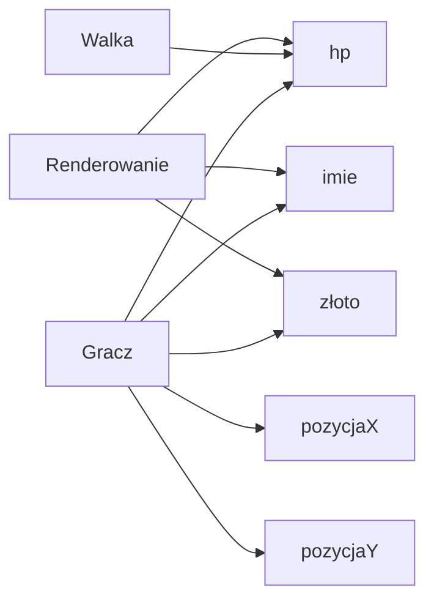
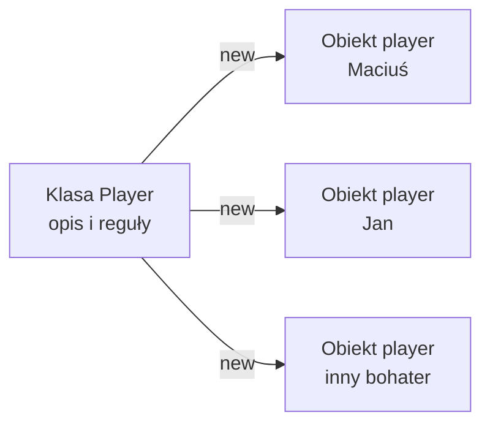
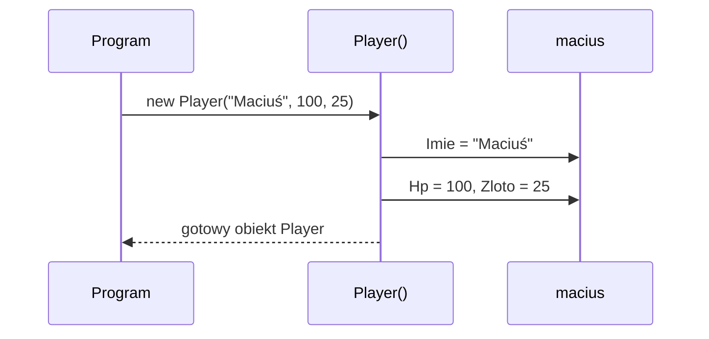
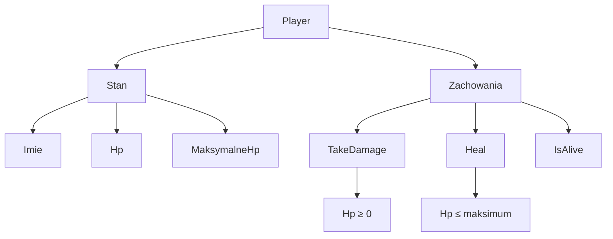
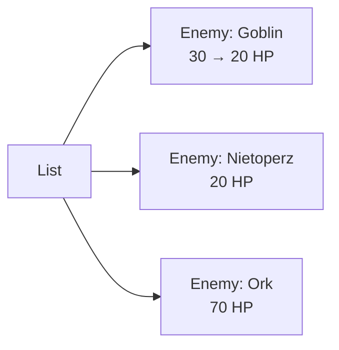
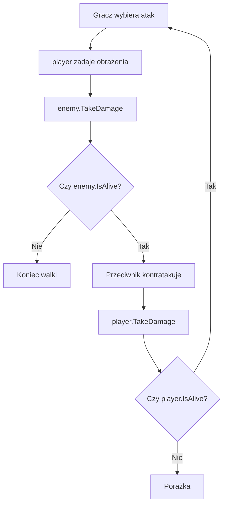

## Cel wykładu

Na początku gry dane bohatera często wyglądają tak:

```csharp
string imieBohatera = "Maciuś";
int hpBohatera = 80;
int zlotoBohatera = 25;
int pozycjaXBohatera = 2;
int pozycjaYBohatera = 4;
```

Po dodaniu przeciwnika pojawia się druga seria zmiennych. Po dodaniu trzeciego — trzecia. Program zaczyna przypominać szufladę z kablami: wszystko działa, dopóki nikt nie próbuje znaleźć właściwego końca.

Na wykładzie nauczymy się opisywać **jeden byt jako obiekt**, który przechowuje swój stan i udostępnia swoje zachowania.

Po wykładzie będziesz potrafić:

- wyjaśnić różnicę między klasą a obiektem,
- zdefiniować prostą klasę w C#,
- utworzyć obiekt za pomocą `new`,
- używać właściwości do opisu stanu obiektu,
- ustawić stan początkowy w konstruktorze,
- dodawać metody zmieniające stan obiektu,
- utworzyć kilku niezależnych przeciwników,
- rozpoznać, kiedy kod należy przenieść do klasy.

> **Zakres:** to praktyczne wprowadzenie do klas i obiektów. Nie wprowadzamy jeszcze dziedziczenia, interfejsów, klas abstrakcyjnych ani polimorfizmu.

---

## 1. Problem: dane jednego bytu są rozrzucone

```csharp
string imie = "Maciuś";
int hp = 80;
int maksymalneHp = 100;
int zloto = 25;
bool maMiecz = true;

Console.WriteLine($"{imie}: {hp}/{maksymalneHp} HP, złoto: {zloto}");
```

Kod jest poprawny, ale każda kolejna funkcja musi znać wszystkie zmienne opisujące bohatera. Łatwo pomylić `hp` bohatera z `hp` przeciwnika albo zapomnieć o jednej zmiennej.

### Diagram problemu



**Wersja tekstowa diagramu:**

```text
Gracz
├── imie
├── hp
├── złoto
├── pozycjaX
└── pozycjaY

Walka, ruch i renderowanie muszą osobno pamiętać,
które zmienne należą do gracza.
```

### Rozmowa Maćka i Jana

> **Maciuś:** Dodałem `hpBohatera`, `hpGoblin1`, `hpGoblin2` i `hpGoblin3`. Teraz gra obsługuje trzech przeciwników!
>
> **Jan:** A jeśli dodasz czwartego?
>
> **Maciuś:** Dopiszę `hpGoblin4`.
>
> **Jan:** A jeśli dodamy smoka?
>
> **Maciuś:** Dopiszę `hpSmoka`.
>
> **Jan:** Gratuluję. Właśnie stworzyłeś ręcznie klasę, tylko bez klasy i z większą liczbą okazji do literówki.

> **Komentarz dla prowadzącego:** Nie zaczynaj od formalnych definicji. Najpierw pokaż koszt rozproszonych zmiennych. Klasa ma rozwiązać konkretny problem organizacyjny.

---

## 2. Klasa i obiekt — przepis i gotowe danie

**Klasa** jest opisem tego, co ma posiadać i potrafić pewien rodzaj obiektów. Można porównać ją do przepisu.

**Obiekt** jest konkretnym egzemplarzem utworzonym na podstawie klasy. To gotowe danie przygotowane według przepisu.



```text
Klasa Player (przepis)
        │ new
        ├── playerMacius  (konkretny obiekt)
        ├── playerJan     (konkretny obiekt)
        └── playerRuda    (konkretny obiekt)
```

Ta sama klasa może utworzyć wiele obiektów. Każdy obiekt ma własne wartości właściwości.

### Pierwsza klasa

```csharp
class Player
{
    public string Imie;
    public int Hp;
}
```

Tworzenie dwóch obiektów:

```csharp
Player macius = new Player();
macius.Imie = "Maciuś";
macius.Hp = 80;

Player jan = new Player();
jan.Imie = "Jan";
jan.Hp = 95;

Console.WriteLine(macius.Imie); // Maciuś
Console.WriteLine(jan.Imie);    // Jan
```

`macius` i `jan` są obiektami tej samej klasy, ale przechowują różne dane.

> **Uwaga:** zapis `new Player()` oznacza „utwórz nowy obiekt klasy `Player`”. Nazwa klasy opisuje typ, a nazwa zmiennej wskazuje konkretny obiekt.

### Pytanie do sali

```csharp
Player a = new Player();
Player b = new Player();

a.Imie = "Ala";
b.Imie = "Bartek";
```

Co wypisze `Console.WriteLine(b.Imie)`? Czy zmiana `a.Imie` zmieni również `b.Imie`?

**Oczekiwana odpowiedź:** wypisze `Bartek`; obiekty są niezależnymi egzemplarzami.

---

## 3. Właściwości — dane obiektu z czytelnym interfejsem

W pierwszym przykładzie użyliśmy publicznych pól. W codziennym kodzie lepiej użyć właściwości:

```csharp
class Player
{
    public string Imie { get; set; }
    public int Hp { get; set; }
    public int Zloto { get; set; }
}
```

`get` oznacza, że wartość można odczytać, a `set`, że można ją ustawić.

```csharp
Player player = new Player();
player.Imie = "Maciuś";
player.Hp = 80;
player.Zloto = 25;

player.Zloto += 10;
Console.WriteLine($"{player.Imie} ma {player.Zloto} sztuk złota.");
```

### Nazwy, które pomagają czytać kod

| Element | Przykład | Rola |
|---|---|---|
| Klasa | `Player` | rodzaj obiektu, PascalCase |
| Obiekt | `player` | konkretny egzemplarz, camelCase |
| Właściwość | `Hp` | dane obiektu, PascalCase |
| Metoda | `TakeDamage()` | zachowanie obiektu, PascalCase |

> **Komentarz dla prowadzącego:** Na tym etapie wystarczy auto-właściwość `{ get; set; }`. Nie rozwijaj jeszcze różnicy między wszystkimi rodzajami właściwości.

---

## 4. Konstruktor — obiekt gotowy do użycia

Nie chcemy tworzyć bohatera w kilku krokach i zastanawiać się, czy ktoś ustawił mu HP. Konstruktor centralizuje stan początkowy.

```csharp
class Player
{
    public string Imie { get; set; }
    public int Hp { get; set; }
    public int MaksymalneHp { get; }
    public int Zloto { get; set; }

    public Player(string imie, int maksymalneHp, int zloto)
    {
        Imie = imie;
        MaksymalneHp = maksymalneHp;
        Hp = maksymalneHp;
        Zloto = zloto;
    }
}
```

Tworzenie obiektu:

```csharp
Player macius = new Player("Maciuś", 100, 25);
Player jan = new Player("Jan", 120, 10);

Console.WriteLine($"{macius.Imie}: {macius.Hp}/{macius.MaksymalneHp} HP");
```

### Publiczne właściwości na początek

```csharp
public int Hp { get; set; }
```

- każdy kod może odczytać `Hp`,
- każdy kod może zmienić `Hp`.

Dzięki temu na tym etapie możemy łatwo obserwować i modyfikować stan obiektu:

```csharp
macius.Hp = 80;
```

> **Ważne:** Na tym etapie wszystkie właściwości przykładowych klas są publiczne. Reguły poprawnej zmiany zdrowia nadal pokazujemy w metodach `TakeDamage` i `Heal`, ale student może bezpośrednio obserwować i zmieniać właściwości.

### Diagram tworzenia obiektu



---

## 5. Metody — obiekt nie tylko przechowuje dane

Jeżeli wszystkie reguły zmiany HP znajdują się w `Program.cs`, klasa nadal jest tylko pudełkiem na dane. Dodajmy zachowania:

```csharp
class Player
{
    public string Imie { get; }
    public int Hp { get; set; }
    public int MaksymalneHp { get; }

    public Player(string imie, int maksymalneHp)
    {
        Imie = imie;
        MaksymalneHp = maksymalneHp;
        Hp = maksymalneHp;
    }

    public void TakeDamage(int obrazenia)
    {
        Hp -= obrazenia;

        if (Hp < 0)
        {
            Hp = 0;
        }
    }

    public void Heal(int leczenie)
    {
        Hp += leczenie;

        if (Hp > MaksymalneHp)
        {
            Hp = MaksymalneHp;
        }
    }

    public bool IsAlive()
    {
        return Hp > 0;
    }
}
```

Użycie:

```csharp
Player player = new Player("Maciuś", 100);

player.TakeDamage(35);
Console.WriteLine(player.Hp); // 65

player.Heal(50);
Console.WriteLine(player.Hp); // 100, a nie 115

Console.WriteLine(player.IsAlive()); // True
```

### Odpowiedzialność klasy



> **Dobra reguła:** jeśli trzeba pamiętać, jak poprawnie zmienić dane obiektu, ta reguła powinna prawdopodobnie trafić do metody tego obiektu.

### Rozmowa Maćka i Jana

> **Jan:** Maciuś, ile masz HP?
>
> **Maciuś:** 65.
>
> **Jan:** To cię uleczę o 500.
>
> **Maciuś:** Super, mam teraz 565 HP i jestem silniejszy od smoka!
>
> **Jan:** Albo użyjemy `Heal`, a klasa dopilnuje limitu.
>
> **Maciuś:** Czyli metoda jest jak strażnik przy bramie HP?
>
> **Jan:** Tak. I nie wpuszcza ani ujemnych punktów życia, ani leczenia do nieskończoności.

---

## 6. Klasa `Enemy` i lista przeciwników

Przeciwnik ma podobne dane, ale na tym etapie tworzymy osobną, prostą klasę:

```csharp
class Enemy
{
    public string Nazwa { get; }
    public int Hp { get; set; }
    public int Obrazenia { get; }

    public Enemy(string nazwa, int hp, int obrazenia)
    {
        Nazwa = nazwa;
        Hp = hp;
        Obrazenia = obrazenia;
    }

    public void TakeDamage(int obrazenia)
    {
        Hp -= obrazenia;

        if (Hp < 0)
        {
            Hp = 0;
        }
    }

    public bool IsAlive()
    {
        return Hp > 0;
    }
}
```

Tworzymy kilku przeciwników:

```csharp
List<Enemy> enemies = new List<Enemy>
{
    new Enemy("Goblin", 30, 8),
    new Enemy("Nietoperz", 20, 5),
    new Enemy("Ork", 70, 15)
};

foreach (Enemy enemy in enemies)
{
    Console.WriteLine($"{enemy.Nazwa}: {enemy.Hp} HP");
}
```

Każdy element listy jest osobnym obiektem:

```csharp
enemies[0].TakeDamage(10);

Console.WriteLine(enemies[0].Hp); // 20
Console.WriteLine(enemies[1].Hp); // 20 — nietknięty nietoperz
```

### Diagram listy obiektów



> **Pułapka:** nie twórz jednego obiektu `Enemy` i nie wkładaj tej samej referencji do listy kilka razy. Każdy przeciwnik powinien powstać przez osobne `new Enemy(...)`.

---

## 7. Prosta walka obiektów

```csharp
Player player = new Player("Maciuś", 100);
Enemy enemy = new Enemy("Goblin", 30, 8);

Console.WriteLine($"{player.Imie} spotyka: {enemy.Nazwa}");

enemy.TakeDamage(12);
Console.WriteLine($"Goblin ma teraz {enemy.Hp} HP.");

if (!enemy.IsAlive())
{
    Console.WriteLine("Przeciwnik został pokonany.");
}
```

Przykładowy przepływ tury:



> **Uwaga projektowa:** `TakeDamage` zmienia stan obiektu, ale nie musi wypisywać komunikatu na konsolę. Dzięki temu regułę można później wykorzystać w innym interfejsie gry.

---

## 8. Refaktoryzacja: przed i po

### Przed — luźne dane

```csharp
string nazwaWroga = "Goblin";
int hpWroga = 30;
int obrazeniaWroga = 8;

hpWroga -= 12;
if (hpWroga < 0)
{
    hpWroga = 0;
}
```

### Po — obiekt z własną regułą

```csharp
Enemy goblin = new Enemy("Goblin", 30, 8);
goblin.TakeDamage(12);
```

### Co zyskaliśmy?

| Przed | Po |
|---|---|
| dane są rozrzucone | dane są razem w obiekcie |
| każda funkcja zna szczegóły HP | klasa pilnuje zmiany HP |
| trzeci przeciwnik wymaga nowych nazw | trzeci przeciwnik to kolejny `new Enemy(...)` |
| łatwo pomylić zmienne | kod mówi, którego obiektu dotyczy operacja |

### Ćwiczenie „przewidź wynik”

```csharp
Enemy goblin = new Enemy("Goblin", 30, 8);
Enemy ork = new Enemy("Ork", 70, 15);

goblin.TakeDamage(10);

Console.WriteLine(goblin.Hp);
Console.WriteLine(ork.Hp);
```

**Odpowiedź:** `20`, a następnie `70`. Zmiana jednego obiektu nie zmienia drugiego.

---

## 9. Najczęstsze błędy

### Pominięcie `new`

```csharp
Player player;
// player.Imie = "Maciuś"; // błąd: obiekt nie został utworzony
```

Sama zmienna typu `Player` nie tworzy obiektu. Potrzebne jest `new Player(...)`.

### Wspólne dane przez przypadek

```csharp
Enemy goblin = new Enemy("Goblin", 30, 8);
Enemy drugiGoblin = goblin;

drugiGoblin.TakeDamage(10);
Console.WriteLine(goblin.Hp); // 20 — to nadal ten sam obiekt
```

`drugiGoblin = goblin` nie tworzy kopii. Obie zmienne wskazują ten sam obiekt.

### Obiekt, który robi wszystko

Klasa `Player` nie powinna jednocześnie czytać klawiatury, rysować mapy, zapisywać pliku i prowadzić sklepu.

> **Klasa powinna mieć jasno określoną odpowiedzialność.**

### Zbyt wczesne komplikowanie projektu

Nie potrzebujemy teraz dziedziczenia, interfejsu `IAttacker`, fabryki przeciwników ani systemu zdarzeń C#. Najpierw trzeba swobodnie tworzyć i modyfikować proste obiekty.

---

## 10. Zadanie aktywizujące: klasa `Item`

Zaprojektuj klasę `Item` dla przedmiotu w ekwipunku. Ma mieć `Nazwa`, `Cena`, `LiczbaSztuk`, konstruktor oraz metody `AddOne()` i `RemoveOne()`.

```csharp
class Item
{
    public string Nazwa { get; }
    public int Cena { get; }
    public int LiczbaSztuk { get; set; }

    public Item(string nazwa, int cena)
    {
        Nazwa = nazwa;
        Cena = cena;
        LiczbaSztuk = 1;
    }

    public void AddOne()
    {
        LiczbaSztuk++;
    }

    public void RemoveOne()
    {
        if (LiczbaSztuk > 0)
        {
            LiczbaSztuk--;
        }
    }
}
```

---

## Podsumowanie

- **Klasa** opisuje rodzaj obiektów.
- **Obiekt** jest konkretnym egzemplarzem klasy.
- `new` tworzy nowy obiekt.
- Właściwości przechowują dane obiektu.
- Konstruktor ustawia poprawny stan początkowy.
- Metody opisują czynności wykonywane przez obiekt.
- Publiczne właściwości pozwalają na prostą obserwację i modyfikację stanu na początku nauki.
- Każde `new Enemy(...)` tworzy niezależnego przeciwnika.
- Klasa powinna mieć jasną odpowiedzialność.
- Na tym etapie nie potrzebujemy jeszcze dziedziczenia ani polimorfizmu.

## Ściąga

```csharp
class Enemy
{
    public string Nazwa { get; }
    public int Hp { get; set; }

    public Enemy(string nazwa, int hp)
    {
        Nazwa = nazwa;
        Hp = hp;
    }

    public void TakeDamage(int obrazenia)
    {
        Hp -= obrazenia;

        if (Hp < 0)
        {
            Hp = 0;
        }
    }

    public bool IsAlive()
    {
        return Hp > 0;
    }
}

Enemy goblin = new Enemy("Goblin", 30);
goblin.TakeDamage(12);
Console.WriteLine($"{goblin.Nazwa}: {goblin.Hp} HP");
```

## Pytania kontrolne

1. Czym różni się klasa `Player` od obiektu `player`?
2. Po co stosujemy konstruktor?
3. Co daje zapis `public int Hp { get; set; }`?
4. Dlaczego `new Enemy("Goblin", 30)` tworzy osobny obiekt?
5. Gdzie powinna znajdować się reguła ograniczająca HP do zera?
6. Dlaczego lepiej wywołać `enemy.TakeDamage(10)` niż zmieniać HP przeciwnika w dziesięciu miejscach?
