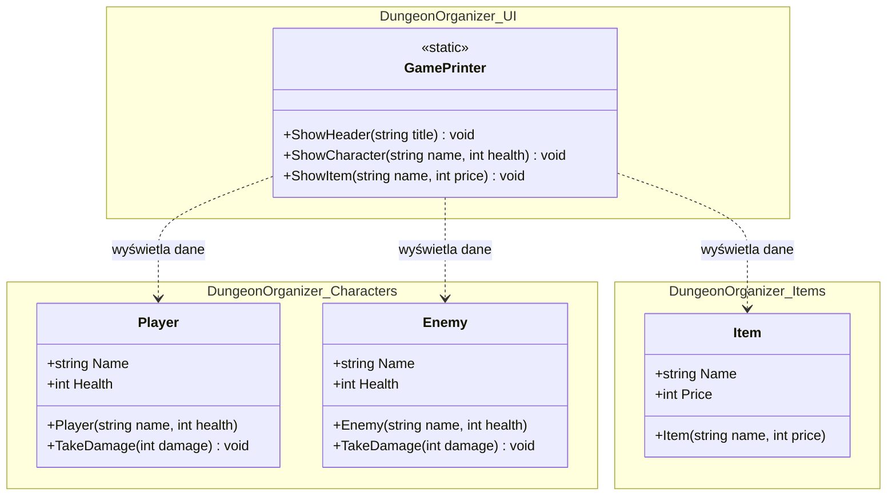
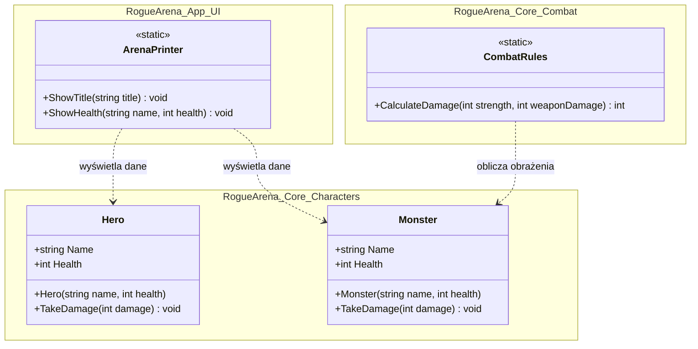
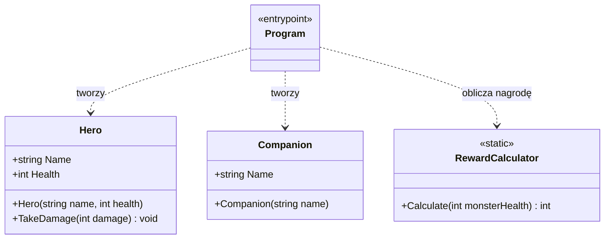
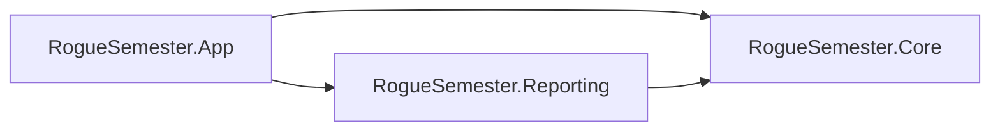

## Cel laboratorium

Podczas laboratorium uporządkujesz kod gry na czterech poziomach: plików `.cs`, przestrzeni nazw, projektów `.csproj` i pliku solucji `.sln`. Nauczysz się rozpoznawać, kiedy potrzebny jest `using`, kiedy `ProjectReference`, a kiedy `PackageReference`.

Do wykonania jest **9 zadań**:

- zadania 1–3 — proste,
- zadania 4–6 — średnie,
- zadania 7–8 — trudne,
- zadanie 9 — samodzielny projekt integracyjny.

```text
jeden projekt  →  importy  →  biblioteka klas  →  zależności  →  projekt końcowy
```

## Zasady pracy

- Dla każdego poziomu utwórz świeżą kopię odpowiedniej bazy kodu.
- Nie kopiuj klas z różnych baz do jednego projektu.
- Każdy plik umieść dokładnie w miejscu wskazanym w strukturze katalogów.
- Po każdym zadaniu wykonaj `dotnet build` i uruchom aplikację.
- Czytaj pierwszy komunikat błędu kompilatora przed dodaniem przypadkowego `using`.
- Nazwy projektów, folderów i namespace zapisuj dokładnie tak, jak podano; C# rozróżnia wielkość liter.
- Zachowaj rozwiązania zadań 1–8 — wykorzystasz je w zadaniu 9.

> **Ważne:** `using`, odwołanie do projektu przez `ProjectReference` i dodanie projektu `.csproj` do pliku `.sln` to trzy różne operacje. W zadaniach należy świadomie wskazywać, która z nich rozwiązuje dany problem.

---

# Poziom prosty — zadania 1–3

## Projekt startowy „Dungeon Organizer” — jeden projekt

Utwórz projekt:

```powershell
dotnet new console --name DungeonOrganizer
cd DungeonOrganizer
```

Utwórz foldery `Characters`, `Items` i `UI`, a następnie dodaj poniższe pliki. Po skopiowaniu baza powinna się kompilować i uruchamiać.

### Struktura

```text
DungeonOrganizer/
├── DungeonOrganizer.csproj
├── Program.cs
├── Characters/
│   ├── Player.cs
│   └── Enemy.cs
├── Items/
│   └── Item.cs
└── UI/
    └── GamePrinter.cs
```

### `Program.cs`

```csharp
using DungeonOrganizer.Characters;
using DungeonOrganizer.Items;
using DungeonOrganizer.UI;

Player player = new Player("Ada", 100);
Enemy enemy = new Enemy("Goblin", 30);
Item item = new Item("Mikstura", 15);

GamePrinter.ShowHeader("Dungeon Organizer");
GamePrinter.ShowCharacter(player.Name, player.Health);
GamePrinter.ShowCharacter(enemy.Name, enemy.Health);
GamePrinter.ShowItem(item.Name, item.Price);
```

<!-- code-result:
=== DUNGEON ORGANIZER ===
Ada: 100 HP
Goblin: 30 HP
Mikstura: 15 szt. złota
-->

### `Characters/Player.cs`

```csharp
namespace DungeonOrganizer.Characters;

public class Player
{
    public string Name { get; }
    public int Health { get; private set; }

    public Player(string name, int health)
    {
        Name = name;
        Health = health;
    }

    public void TakeDamage(int damage)
    {
        Health -= damage;

        if (Health < 0)
        {
            Health = 0;
        }
    }
}
```

### `Characters/Enemy.cs`

```csharp
namespace DungeonOrganizer.Characters;

public class Enemy
{
    public string Name { get; }
    public int Health { get; private set; }

    public Enemy(string name, int health)
    {
        Name = name;
        Health = health;
    }

    public void TakeDamage(int damage)
    {
        Health -= damage;

        if (Health < 0)
        {
            Health = 0;
        }
    }
}
```

### `Items/Item.cs`

```csharp
namespace DungeonOrganizer.Items;

public class Item
{
    public string Name { get; }
    public int Price { get; }

    public Item(string name, int price)
    {
        Name = name;
        Price = price;
    }
}
```

### `UI/GamePrinter.cs`

```csharp
namespace DungeonOrganizer.UI;

public static class GamePrinter
{
    public static void ShowHeader(string title)
    {
        Console.WriteLine($"=== {title.ToUpper()} ===");
    }

    public static void ShowCharacter(string name, int health)
    {
        Console.WriteLine($"{name}: {health} HP");
    }

    public static void ShowItem(string name, int price)
    {
        Console.WriteLine($"{name}: {price} szt. złota");
    }
}
```

### Diagram klas projektu startowego



```text
Player i Enemy należą do DungeonOrganizer.Characters.
Item należy do DungeonOrganizer.Items.
GamePrinter należy do DungeonOrganizer.UI i wyświetla przekazane dane.
```

Uruchom projekt startowy:

```powershell
dotnet run
```

---

## Zadanie 1. Proste — mapa plików i przestrzeni nazw

> **Maciek:** Przeniosłem `Weapon.cs` do folderu `Characters`. Miecz jest teraz postacią?
>
> **Jan:** Tylko jeśli zacznie podejmować własne decyzje. Folder pomaga nam znaleźć plik, ale nie zmienia jego namespace ani osobowości.

Na podstawie projektu startowego „Dungeon Organizer” przygotuj tabelę zawierającą dla każdego typu:

1. nazwę pliku,
2. nazwę folderu,
3. krótką nazwę typu,
4. namespace,
5. pełną nazwę typu.

Następnie dodaj plik `Items/Weapon.cs`:

```csharp
namespace DungeonOrganizer.Items;

public class Weapon
{
    public string Name { get; }
    public int Damage { get; }

    public Weapon(string name, int damage)
    {
        Name = name;
        Damage = damage;
    }
}
```

W `Program.cs` utwórz miecz i wyświetl:

```text
Miecz zadaje 8 obrażeń.
```

### Eksperyment

Przenieś `Weapon.cs` do folderu `Characters`, ale nie zmieniaj deklaracji namespace. Zbuduj projekt i odpowiedz:

- czy kod nadal się kompiluje,
- jaka jest pełna nazwa `Weapon`,
- czy folder automatycznie zmienił namespace.

Po eksperymencie przenieś plik z powrotem do `Items`.

### Kryteria ukończenia

- [ ] Tabela poprawnie rozróżnia folder, namespace i pełną nazwę typu.
- [ ] `Weapon` należy do `DungeonOrganizer.Items`.
- [ ] Program tworzy obiekt `Weapon` i wyświetla jego dane.
- [ ] Student potrafi wyjaśnić wynik eksperymentu z przeniesieniem pliku.

---

## Zadanie 2. Proste — pełna nazwa i dyrektywa `using`

> **Maciek:** Usunąłem `using` i klasa zniknęła. Czy kompilator ją skasował?
>
> **Jan:** Nie. Zgubiłeś skrót do adresu, nie budynek. Podaj pełną nazwę typu, a znowu go znajdziesz.

W kopii projektu po zadaniu 1 usuń z `Program.cs`:

```csharp
using DungeonOrganizer.Items;
```

Nie dodawaj go ponownie. Zmień wyłącznie odwołania do `Item` i `Weapon`, używając ich pełnych nazw:

```csharp
DungeonOrganizer.Items.Item item =
    new DungeonOrganizer.Items.Item("Mikstura", 15);
```

Samodzielnie zapisz analogiczną deklarację `Weapon`. Uruchom program, a następnie:

1. przywróć `using DungeonOrganizer.Items;`,
2. skróć nazwy obu typów,
3. porównaj działanie obu wersji,
4. zapisz jednym zdaniem, co zmieniło się w programie wynikowym.

### Pytania

- Czy `using` tworzy obiekt?
- Czy `using` dodaje plik do projektu?
- Czy wersja z pełną nazwą reprezentuje inny typ niż wersja krótka?
- W jakim zakresie działa zwykła dyrektywa `using`?

### Kryteria ukończenia

- [ ] Program działa bez importu dzięki pełnym nazwom typów.
- [ ] Po przywróceniu importu korzysta z krótkich nazw.
- [ ] Obie wersje dają ten sam wynik.
- [ ] Student potrafi wyjaśnić, że `using` skraca zapis dostępnej nazwy.

---

## Zadanie 3. Proste — konflikt nazw i alias

> **Maciek:** Mam dwa typy `Item`. Kompilator powinien przecież zgadnąć, który mam na myśli.
>
> **Jan:** Oczywiście. Zaraz potem wybierze ci też obiad i odpowie za ciebie na egzaminie. Nadaj typom aliasy.

Dodaj folder `World` oraz plik `World/Item.cs`:

```csharp
namespace DungeonOrganizer.World;

public class Item
{
    public string Symbol { get; }

    public Item(string symbol)
    {
        Symbol = symbol;
    }
}
```

Na początku `Program.cs` umieść oba importy:

```csharp
using DungeonOrganizer.Items;
using DungeonOrganizer.World;
```

Spróbuj utworzyć obiekt przez `new Item(...)`. Przeczytaj błąd kompilatora. Następnie rozwiąż konflikt za pomocą aliasów:

```csharp
using InventoryItem = DungeonOrganizer.Items.Item;
using MapItem = DungeonOrganizer.World.Item;
```

Utwórz:

- przedmiot ekwipunku `InventoryItem` o nazwie `"Mikstura"` i cenie `15`,
- element mapy `MapItem` o symbolu `"!"`.

Wyświetl:

```text
Przedmiot: Mikstura, cena: 15
Symbol na mapie: !
```

### Wymagania

- Zachowaj obie klasy o krótkiej nazwie `Item`.
- Nie zmieniaj nazwy żadnej klasy tylko po to, aby ukryć konflikt.
- W kodzie tworzącym obiekty użyj aliasów.
- Zapisz pełne nazwy obu typów w komentarzu.

### Kryteria ukończenia

- [ ] Student potrafi odtworzyć konflikt nazw.
- [ ] Alias jednoznacznie wskazuje każdy typ.
- [ ] Program wyświetla dane obu niezależnych obiektów.
- [ ] Student rozumie, że alias nie zmienia nazwy klasy.

---

# Poziom średni — zadania 4–6

## Plik solucji „Rogue Arena” — aplikacja i biblioteka

Zacznij w nowym pustym katalogu `RogueArena`. Utwórz plik solucji `RogueArena.sln` oraz dwa projekty `.csproj`:

```powershell
dotnet new sln --name RogueArena --format sln
dotnet new console --name RogueArena.App
dotnet new classlib --name RogueArena.Core

dotnet sln .\RogueArena.sln add .\RogueArena.App\RogueArena.App.csproj
dotnet sln .\RogueArena.sln add .\RogueArena.Core\RogueArena.Core.csproj

dotnet add .\RogueArena.App\RogueArena.App.csproj reference .\RogueArena.Core\RogueArena.Core.csproj
```

Usuń wygenerowany plik `RogueArena.Core/Class1.cs`. Utwórz poniższą strukturę i skopiuj kod.

```text
RogueArena/
├── RogueArena.sln
├── RogueArena.App/
│   ├── RogueArena.App.csproj
│   ├── Program.cs
│   └── UI/
│       └── ArenaPrinter.cs
└── RogueArena.Core/
    ├── RogueArena.Core.csproj
    ├── Characters/
    │   ├── Hero.cs
    │   └── Monster.cs
    └── Combat/
        └── CombatRules.cs
```

### `RogueArena.Core/Characters/Hero.cs`

```csharp
namespace RogueArena.Core.Characters;

public class Hero
{
    public string Name { get; }
    public int Health { get; private set; }

    public Hero(string name, int health)
    {
        Name = name;
        Health = health;
    }

    public void TakeDamage(int damage)
    {
        Health -= damage;

        if (Health < 0)
        {
            Health = 0;
        }
    }
}
```

### `RogueArena.Core/Characters/Monster.cs`

```csharp
namespace RogueArena.Core.Characters;

public class Monster
{
    public string Name { get; }
    public int Health { get; private set; }

    public Monster(string name, int health)
    {
        Name = name;
        Health = health;
    }

    public void TakeDamage(int damage)
    {
        Health -= damage;

        if (Health < 0)
        {
            Health = 0;
        }
    }
}
```

### `RogueArena.Core/Combat/CombatRules.cs`

```csharp
namespace RogueArena.Core.Combat;

public static class CombatRules
{
    public static int CalculateDamage(int strength, int weaponDamage)
    {
        return strength + weaponDamage;
    }
}
```

### `RogueArena.App/UI/ArenaPrinter.cs`

```csharp
namespace RogueArena.App.UI;

public static class ArenaPrinter
{
    public static void ShowTitle(string title)
    {
        Console.WriteLine($"=== {title.ToUpper()} ===");
    }

    public static void ShowHealth(string name, int health)
    {
        Console.WriteLine($"{name}: {health} HP");
    }
}
```

### `RogueArena.App/Program.cs`

```csharp
using RogueArena.App.UI;
using RogueArena.Core.Characters;
using RogueArena.Core.Combat;

Hero hero = new Hero("Ada", 100);
Monster monster = new Monster("Ork", 45);

int damage = CombatRules.CalculateDamage(7, 5);
monster.TakeDamage(damage);

ArenaPrinter.ShowTitle("Rogue Arena");
Console.WriteLine($"{hero.Name} zadaje {damage} obrażeń.");
ArenaPrinter.ShowHealth(monster.Name, monster.Health);
```

<!-- code-result:
=== ROGUE ARENA ===
Ada zadaje 12 obrażeń.
Ork: 33 HP
-->

### Diagram klas projektów z pliku `.sln`



```text
RogueArena.App
└── ArenaPrinter — prezentacja danych

RogueArena.Core
├── Hero i Monster — model postaci
└── CombatRules — reguły obliczania obrażeń
```

Zbuduj plik solucji i uruchom projekt aplikacji:

```powershell
dotnet build .\RogueArena.sln
dotnet run --project .\RogueArena.App\RogueArena.App.csproj
```

---

## Zadanie 4. Średnie — plik `.sln` a zależność projektu

> **Maciek:** Oba projekty są widoczne w Solution Explorerze, więc na pewno się znają.
>
> **Jan:** Ja też widzę sąsiada przez okno, ale to nie znaczy, że mam klucz do jego mieszkania. Potrzebujesz `ProjectReference`.

Przeprowadź dwa kontrolowane eksperymenty.

### Eksperyment A — projekt poza plikiem `.sln`

Usuń `RogueArena.Core.csproj` wyłącznie z pliku `RogueArena.sln`:

```powershell
dotnet sln .\RogueArena.sln remove .\RogueArena.Core\RogueArena.Core.csproj
```

Następnie wykonaj:

```powershell
dotnet build .\RogueArena.App\RogueArena.App.csproj
```

Zapisz wynik i wyjaśnij, dlaczego aplikacja nadal może znać bibliotekę. Potem dodaj projekt `.csproj` z powrotem do pliku `.sln`.

### Eksperyment B — brak odwołania

Usuń `ProjectReference` z `RogueArena.App.csproj`, ale pozostaw oba projekty wpisane w pliku `.sln`. Zbuduj plik `.sln` i przeczytaj błędy.

Przywróć zależność poleceniem:

```powershell
dotnet add .\RogueArena.App\RogueArena.App.csproj reference .\RogueArena.Core\RogueArena.Core.csproj
```

### Do oddania

Uzupełnij tabelę:

| Operacja | Projekt wpisany do pliku `.sln`? | Typy dostępne dla aplikacji? |
|---|---|---|
| `dotnet sln add` | ... | ... |
| `ProjectReference` | ... | ... |
| `using` | ... | ... |

### Kryteria ukończenia

- [ ] Student odróżnia wpis projektu w pliku `.sln` od zależności kompilacji.
- [ ] Po eksperymentach oba projekty ponownie są wpisane do pliku `.sln`.
- [ ] `RogueArena.App` ma dokładnie jedno odwołanie do `RogueArena.Core`.
- [ ] Całość ponownie się buduje i uruchamia.

---

## Zadanie 5. Średnie — nowy moduł ekwipunku

> **Maciek:** Umieszczę `Inventory` w `Program.cs`. Przecież aplikacja i tak go używa.
>
> **Jan:** Lodówka też używa prądu, ale elektrownia nie stoi w kuchni. Model ekwipunku należy do biblioteki z regułami gry.

Rozbuduj bibliotekę `RogueArena.Core` o folder `Items` i dwie klasy.

### `Items/Item.cs`

```csharp
namespace RogueArena.Core.Items;

public class Item
{
    public string Name { get; }
    public int Price { get; }

    public Item(string name, int price)
    {
        Name = name;
        Price = price;
    }
}
```

### `Items/Inventory.cs`

```csharp
namespace RogueArena.Core.Items;

public class Inventory
{
    public List<Item> Items { get; } = new List<Item>();

    public void Add(Item item)
    {
        Items.Add(item);
    }

    public int CalculateValue()
    {
        int total = 0;

        foreach (Item item in Items)
        {
            total += item.Price;
        }

        return total;
    }
}
```

W aplikacji:

1. zaimportuj `RogueArena.Core.Items`,
2. utwórz `Inventory`,
3. dodaj `Miecz` za 40 i `Mikstura` za 15,
4. wyświetl wszystkie przedmioty,
5. wyświetl łączną wartość `55`.

Nie przenoś klas `Item` i `Inventory` do projektu aplikacji. To model i reguły domenowe, więc pozostają w bibliotece.

### Eksperyment z dostępnością

Tymczasowo usuń `public` z deklaracji `Inventory`. Zbuduj plik `.sln`, przeczytaj błąd, a następnie przywróć `public`.

### Kryteria ukończenia

- [ ] Nowe klasy należą do projektu `RogueArena.Core`.
- [ ] Namespace odpowiada logicznej roli `RogueArena.Core.Items`.
- [ ] Aplikacja używa klas przez istniejący `ProjectReference`.
- [ ] Łączna wartość jest liczona w `Inventory`, a nie w `Program.cs`.
- [ ] Student potrafi wyjaśnić różnicę między `public` a domyślnym `internal`.

---

## Zadanie 6. Średnie — importy globalne i granice projektów

> **Maciek:** Dodałem `global using` w aplikacji. Teraz wszystkie projekty na komputerze powinny go widzieć.
>
> **Jan:** „Globalny” oznacza cały projekt, nie całą planetę. Biblioteka nadal potrzebuje własnych importów.

W projekcie `RogueArena.App` utwórz plik `GlobalUsings.cs`:

```csharp
global using RogueArena.App.UI;
global using RogueArena.Core.Characters;
global using RogueArena.Core.Combat;
global using RogueArena.Core.Items;
```

Usuń odpowiadające im zwykłe dyrektywy z `Program.cs`. Sprawdź, czy aplikacja nadal działa.

Następnie w `RogueArena.Core` dodaj `GlobalUsings.cs`:

```csharp
global using System.Collections.Generic;
```

Wykonaj eksperyment:

1. wyłącz `ImplicitUsings` tylko w `RogueArena.Core.csproj`, ustawiając `disable`,
2. sprawdź, czy `Inventory` nadal rozpoznaje `List<T>` dzięki `global using`,
3. usuń na chwilę import globalny i przeczytaj błąd,
4. przywróć import,
5. pozostaw `ImplicitUsings` wyłączone w bibliotece.

Odpowiedz:

- Czy `global using` z `RogueArena.App` działa również w `RogueArena.Core`?
- Dlaczego każdy projekt potrzebuje własnego zestawu importów?
- Czy `global using` tworzy zależność między projektami?
- Jaki jest zasięg zwykłego, a jaki globalnego `using`?

### Kryteria ukończenia

- [ ] `Program.cs` korzysta z importów globalnych aplikacji.
- [ ] Biblioteka ma własny, niezależny `GlobalUsings.cs`.
- [ ] Student potrafi wyjaśnić, że `global using` działa w granicach jednego projektu.
- [ ] Wszystkie projekty z pliku `.sln` budują się przy wyłączonych importach niejawnych biblioteki.

---

# Poziom trudny — zadania 7–8

## Plik solucji diagnostycznej „Broken Quest” — `.sln` do naprawy

Skopiuj ukończony plik solucji „Rogue Arena” wraz z projektami po zadaniu 6 do nowego katalogu `BrokenQuest`. Zmień nazwę katalogu tylko na poziomie systemu plików — nazwa pliku `.sln` i nazwy projektów `.csproj` mogą pozostać `RogueArena.*`.

Następnie celowo wprowadź poniższe wersje plików. Projekty z diagnostycznego pliku `.sln` **mają zawierać błędy**. Zadania 7 i 8 polegają na ich systematycznym znalezieniu oraz dalszej rozbudowie.

### `RogueArena.Core/Characters/Companion.cs`

```csharp
namespace RogueArena.Core.Character;

class Companion
{
    public string Name { get; }

    public Companion(string name)
    {
        Name = name;
    }
}
```

### `RogueArena.Core/Rewards/RewardCalculator.cs`

```csharp
namespace RogueArena.Core.Rewards;

public static class RewardCalculator
{
    public static int Calculate(int monsterHealth)
    {
        return monsterHealth / 3;
    }
}
```

### Zastępczy `RogueArena.App/Program.cs`

```csharp
using RogueArena.Core.Characters;
using RogueArena.Core.Reward;

Hero hero = new Hero("Ada", 100);
Companion companion = new Companion("Borys");

int reward = RewardCalculator.Calculate(45);

Console.WriteLine($"Bohater: {hero.Name}");
Console.WriteLine($"Towarzysz: {companion.Name}");
Console.WriteLine($"Nagroda: {reward} szt. złota");
```

### Dodatkowa zmiana

Usuń `ProjectReference` do `RogueArena.Core` z `RogueArena.App.csproj`, ale pozostaw oba projekty wpisane w pliku `.sln`.

### Diagram klas projektów z diagnostycznego pliku `.sln`

Diagram pokazuje typy, które powinny współpracować w scenariuszu. Nie rozstrzyga, czy ich namespace, dostępność i zależności projektów są obecnie poprawne — to należy ustalić w zadaniu 7.



```text
Program potrzebuje trzech typów z biblioteki Core:
Hero, Companion i RewardCalculator.

Kompilator ma pomóc ustalić, dlaczego nie wszystkie są dostępne.
```

---

## Zadanie 7. Trudne — śledztwo kompilatora

> **Maciek:** Kompilator pokazał dwanaście błędów, więc zrobiłem dwanaście przypadkowych zmian.
>
> **Jan:** Doskonała metoda, jeśli celem jest dwadzieścia cztery błędy. Zacznij od pierwszego komunikatu i naprawiaj po jednej przyczynie.

Napraw projekty z pliku solucji „Broken Quest” bez przenoszenia klas do projektu aplikacji i bez kopiowania ich do `Program.cs`.

### Procedura

1. Uruchom `dotnet build .\RogueArena.sln`.
2. Zapisz pierwszy komunikat błędu.
3. Przypisz go do jednej kategorii:
   - literówka lub zła nazwa,
   - błędny namespace albo import,
   - brak zależności projektu,
   - niewłaściwa dostępność typu.
4. Napraw tylko jedną przyczynę.
5. Ponów budowanie.
6. Powtarzaj, aż wszystkie projekty z pliku `.sln` się skompilują.

### Warunki rozwiązania

Po naprawie:

- `Companion` ma należeć do `RogueArena.Core.Characters`,
- `RewardCalculator` ma pozostać w `RogueArena.Core.Rewards`,
- wszystkie typy używane przez aplikację mają być dostępne poza biblioteką,
- aplikacja ma mieć odwołanie do biblioteki,
- importy mają odpowiadać rzeczywistym namespace,
- program ma wyświetlić bohatera, towarzysza i nagrodę `15`.

### Raport błędów

Oddaj tabelę z co najmniej czterema wierszami:

| Objaw lub komunikat | Przyczyna | Warstwa | Naprawa |
|---|---|---|---|
| ... | ... | namespace / using / projekt / dostępność | ... |

### Ograniczenia

- Nie usuwaj problematycznych klas.
- Nie zmieniaj wszystkich namespace na jeden wspólny.
- Nie dodawaj losowych importów bez wskazania typu, który mają udostępnić.
- Nie dodawaj zależności w przeciwnym kierunku z biblioteki do aplikacji.

### Kryteria ukończenia

- [ ] Wszystkie cztery kategorie problemów zostały rozpoznane.
- [ ] Każda naprawa odpowiada rzeczywistej przyczynie.
- [ ] Końcowy kierunek zależności to `RogueArena.App → RogueArena.Core`.
- [ ] Wszystkie projekty z pliku `.sln` kompilują się bez błędów.
- [ ] Raport opisuje tok diagnozy, a nie tylko stan końcowy.

---

## Zadanie 8. Trudne — trzeci projekt i poprawny kierunek zależności

> **Maciek:** Najprościej będzie, jeśli każdy projekt będzie zależał od każdego. Nikt nie poczuje się pominięty.
>
> **Jan:** Projekty nie potrzebują integracyjnego ogniska. Potrzebują kierunku zależności, który nie prowadzi w kółko.

Rozbuduj naprawiony plik `.sln` o projekt biblioteki raportów:

```powershell
dotnet new classlib --name RogueArena.Reporting
dotnet sln .\RogueArena.sln add .\RogueArena.Reporting\RogueArena.Reporting.csproj
dotnet add .\RogueArena.Reporting\RogueArena.Reporting.csproj reference .\RogueArena.Core\RogueArena.Core.csproj
dotnet add .\RogueArena.App\RogueArena.App.csproj reference .\RogueArena.Reporting\RogueArena.Reporting.csproj
```

Docelowy graf:

```text
RogueArena.App ─────► RogueArena.Core
       │                    ▲
       └────► RogueArena.Reporting ─────┘
```

`Core` nie może zależeć od `App` ani od `Reporting`.

### Kod startowy raportowania

Utwórz `RogueArena.Reporting/BattleReport.cs`:

```csharp
using RogueArena.Core.Characters;

namespace RogueArena.Reporting;

public static class BattleReport
{
    public static string Create(Hero hero, Monster monster, int reward)
    {
        return $"{hero.Name} pokonał: {monster.Name}; nagroda: {reward}.";
    }
}
```

W aplikacji:

1. utwórz bohatera i potwora,
2. oblicz nagrodę przez `RewardCalculator`,
3. utwórz tekst przez `BattleReport.Create`,
4. wyświetl raport.

### Rozbudowa

Dodaj do projektu raportowania klasę `PartyReport`, która przyjmuje `Hero` i `Companion` oraz zwraca tekst:

```text
Drużyna: Ada i Borys.
```

Następnie:

- narysuj rzeczywisty graf zależności trzech projektów,
- wskaż, który `ProjectReference` daje raportowaniu dostęp do klas postaci,
- wskaż, który `ProjectReference` daje aplikacji dostęp do `BattleReport`,
- udowodnij eksperymentem, że samo `using RogueArena.Reporting;` nie wystarcza po usunięciu odwołania projektu,
- przywróć odwołanie i działający stan.

### Kryteria ukończenia

- [ ] Plik `.sln` zawiera wpisy trzech projektów `.csproj`.
- [ ] Wszystkie projekty zostały dodane do pliku `.sln`.
- [ ] Zależności są jednokierunkowe i nie tworzą cyklu.
- [ ] `Reporting` korzysta z publicznych typów `Core`.
- [ ] `App` uruchamia scenariusz i wyświetla oba raporty.
- [ ] Student potrafi odróżnić import namespace od odwołania projektu.

---

# Zadanie projektowe

## Zadanie 9. Projekt — „Rogue Semester: modułowa wyprawa”

> **Maciek:** Mam już trzy projekty, siedem namespace i czternaście `using`. Czy to znaczy, że architektura jest dobra?
>
> **Jan:** Nie. To znaczy, że umiesz liczyć. Dobra architektura będzie wtedy, gdy każdy element ma jasne zadanie, a całość nadal daje się uruchomić.

Zaprojektuj i wykonaj samodzielną aplikację konsolową wykorzystującą rozwiązania oraz doświadczenia z zadań 1–8. Projekt ma symulować krótką wyprawę bohatera: wybór postaci, serię walk, zbieranie przedmiotów i raport końcowy.

Nie otrzymujesz kompletnego kodu startowego. Możesz kopiować i dostosowywać własne poprawne klasy z wcześniejszych zadań.

## Minimalna struktura pliku `.sln` i projektów

```text
RogueSemester/
├── RogueSemester.sln
├── RogueSemester.App/
│   ├── RogueSemester.App.csproj
│   ├── Program.cs
│   └── UI/
├── RogueSemester.Core/
│   ├── RogueSemester.Core.csproj
│   ├── Characters/
│   ├── Combat/
│   └── Items/
└── RogueSemester.Reporting/
    ├── RogueSemester.Reporting.csproj
    └── Reports/
```

Dozwolona jest bardziej szczegółowa organizacja, ale plik solucji `.sln` musi zawierać co najmniej trzy powyższe projekty `.csproj`.

## Odpowiedzialności projektów

### `RogueSemester.Core`

Biblioteka przechowuje model i reguły gry:

- `Player`,
- `Enemy`,
- `Item` lub `Weapon`,
- `Inventory`,
- `CombatRules`.

Nie może czytać danych przez `Console.ReadLine()` ani wyświetlać menu. Typy potrzebne innym projektom mają być `public`.

### `RogueSemester.Reporting`

Biblioteka zależy od `Core` i tworzy tekstowe raporty:

- raport stanu bohatera,
- raport przebiegu lub wyniku walki,
- raport końcowy wyprawy.

Nie może zależeć od `App`.

### `RogueSemester.App`

Aplikacja odpowiada za:

- wejście użytkownika,
- menu,
- wyświetlanie komunikatów,
- sterowanie przebiegiem wyprawy,
- użycie klas z `Core` i `Reporting`.

## Wymagany przebieg

Program powinien:

1. pobrać imię bohatera,
2. utworzyć bohatera z punktami życia i początkowym ekwipunkiem,
3. utworzyć co najmniej trzech różnych przeciwników,
4. pozwolić rozpocząć kolejne walki,
5. obliczać obrażenia za pomocą reguł z `Core`,
6. nie pozwalać zdrowiu spaść poniżej zera,
7. przyznawać przedmiot albo złoto po wygranej,
8. przechowywać przedmioty w `Inventory`,
9. umożliwiać wyświetlenie raportu stanu w dowolnej turze,
10. zakończyć wyprawę po pokonaniu przeciwników, śmierci bohatera albo wyborze wyjścia,
11. wyświetlić raport końcowy utworzony przez projekt `Reporting`.

## Wymagania dotyczące namespace i importów

- Każdy własny typ ma jawnie zadeklarowany namespace.
- Namespace rozpoczyna się nazwą odpowiedniego projektu.
- Foldery i namespace mają spójną strukturę.
- W co najmniej jednym miejscu użyj pełnej nazwy typu zamiast `using` i dodaj komentarz wyjaśniający cel.
- W co najmniej jednym miejscu zastosuj alias rozwiązujący rzeczywisty albo świadomie przygotowany konflikt krótkich nazw.
- Utwórz co najmniej jeden uzasadniony `global using`.
- Nie dodawaj nieużywanych importów.

## Wymagania dotyczące projektów

- Wszystkie projekty `.csproj` są wpisane do jednego pliku solucji `.sln`.
- `App` ma odwołanie do `Core` i `Reporting`.
- `Reporting` ma odwołanie do `Core`.
- `Core` nie ma odwołania do pozostałych projektów.
- Graf projektów nie zawiera zależności cyklicznych.
- Każdy projekt buduje się podczas budowania pliku `.sln`.

## Diagram wymaganych zależności



## Przykładowy przebieg

```text
=== ROGUE SEMESTER ===
Podaj imię bohatera: Ada

1. Rozpocznij następną walkę
2. Pokaż stan bohatera
3. Pokaż ekwipunek
4. Zakończ wyprawę
Wybór: 1

Ada spotyka: Goblin (30 HP)
Ada zadaje 12 obrażeń.
Goblin zadaje 6 obrażeń.
...
Pokonano: Goblin. Nagroda: Mikstura.

=== RAPORT KOŃCOWY ===
Bohater: Ada
Zdrowie: 58/100
Pokonani przeciwnicy: 3
Zdobyte złoto: 40
Przedmioty: Miecz, Mikstura
Powód zakończenia: ukończono wyprawę
```

Dokładny wygląd komunikatów może być inny, jeśli wszystkie wymagane informacje pozostają czytelne.

## Dokumentacja projektu

Dołącz plik `README.md`, który zawiera:

1. krótki opis programu,
2. instrukcję budowania i uruchamiania,
3. drzewo projektów, folderów i najważniejszych plików,
4. graf zależności projektów,
5. tabelę co najmniej sześciu ważnych typów z ich pełnymi nazwami,
6. wyjaśnienie użytego aliasu i `global using`,
7. opis trzech problemów napotkanych podczas pracy i sposobu ich rozwiązania.

## Scenariusze testowe

Sprawdź co najmniej:

1. zbudowanie wszystkich projektów z pliku `.sln` jednym poleceniem,
2. uruchomienie właściwego projektu aplikacji,
3. pustą nazwę bohatera,
4. pokonanie jednego i wszystkich przeciwników,
5. spadek zdrowia bohatera dokładnie do zera i poniżej zera przed ograniczeniem,
6. wyświetlenie pustego oraz niepustego ekwipunku,
7. ręczne usunięcie jednego `using` i użycie pełnej nazwy,
8. usunięcie `ProjectReference`, obserwację błędu i przywrócenie zależności,
9. poprawność raportu końcowego dla każdego powodu zakończenia.

## Kryteria ukończenia projektu

- [ ] Plik `.sln` zawiera co najmniej trzy poprawnie nazwane projekty `.csproj`.
- [ ] Każdy typ znajduje się w logicznym pliku, folderze i namespace.
- [ ] Graf zależności jest zgodny z wymaganiami i nie ma cykli.
- [ ] `Core` nie obsługuje konsoli.
- [ ] `Reporting` tworzy raporty na podstawie publicznych typów `Core`.
- [ ] `App` steruje kompletnym przebiegiem wyprawy.
- [ ] Zwykłe importy, import globalny, pełna nazwa i alias zostały użyte świadomie.
- [ ] Program obsługuje wszystkie trzy sposoby zakończenia wyprawy.
- [ ] Raport końcowy zawiera wymagane dane.
- [ ] `README.md` opisuje strukturę oraz decyzje projektowe.
- [ ] `dotnet build` kończy się bez błędów i ostrzeżeń wynikających z kodu studenta.

---

## Pytania kontrolne

1. Czym różni się folder od namespace?
2. Co jest pełną nazwą typu?
3. Czy `using` pobiera albo instaluje bibliotekę?
4. Kiedy potrzebna jest pełna nazwa typu?
5. Jak rozwiązać konflikt dwóch typów o krótkiej nazwie `Item`?
6. Jaki zasięg ma `global using`?
7. Co opisuje plik `.csproj`?
8. Czym różni się aplikacja od biblioteki klas?
9. Czy dodanie projektu `.csproj` do pliku `.sln` tworzy `ProjectReference`?
10. Dlaczego typ z biblioteki często musi być `public`?
11. Czym różnią się `ProjectReference` i `PackageReference`?
12. Dlaczego biblioteka reguł gry nie powinna zależeć od aplikacji konsolowej?
13. Jak rozpoznać zależność cykliczną?
14. W jakiej kolejności diagnozować nierozpoznany typ?

## Co oddać

- rozwiązania zadań 1–3 wykonane w projekcie „Dungeon Organizer”,
- rozwiązania zadań 4–6 wykonane w projektach z pliku `RogueArena.sln`,
- naprawiony i rozbudowany plik `.sln` wraz z projektami zadań 7–8,
- kompletny projekt z zadania 9,
- raport błędów z zadania 7,
- `README.md` projektu końcowego,
- tekstowy przykład działania lub zrzuty konsoli,
- krótką listę wykonanych scenariuszy testowych.

## Podsumowanie

Po ukończeniu laboratorium potrafisz:

- organizować typy w przestrzeniach nazw,
- korzystać z pełnych nazw, importów i aliasów,
- rozróżniać zwykłe, globalne i niejawne importy,
- odczytywać podstawową strukturę `.csproj`,
- tworzyć aplikacje oraz biblioteki klas,
- grupować projekty `.csproj` w pliku solucji `.sln`,
- dodawać poprawne zależności między projektami,
- diagnozować brak namespace, importu, dostępności lub odwołania,
- projektować jednokierunkowy graf zależności,
- budować małą, modułową aplikację .NET.
