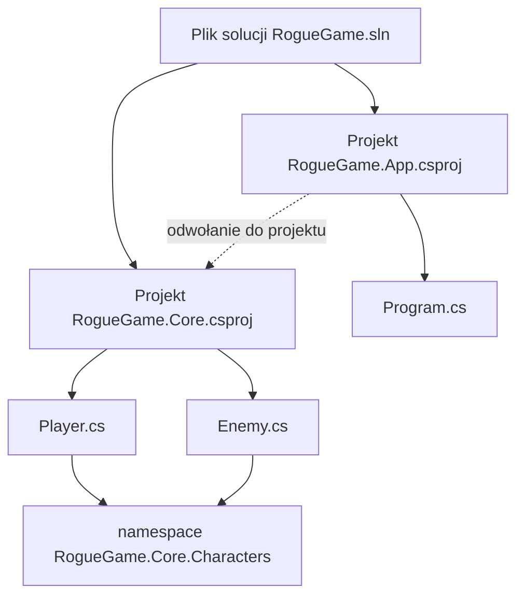
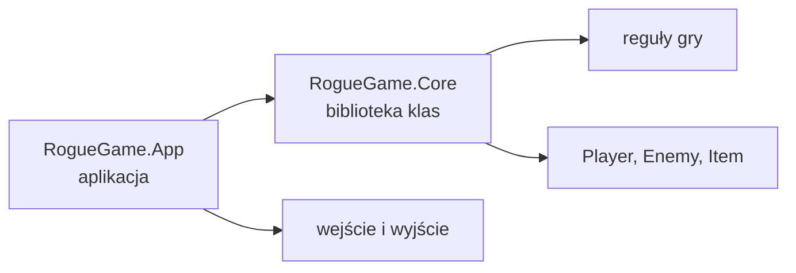
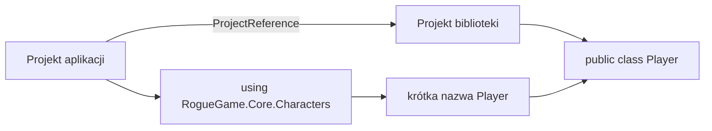
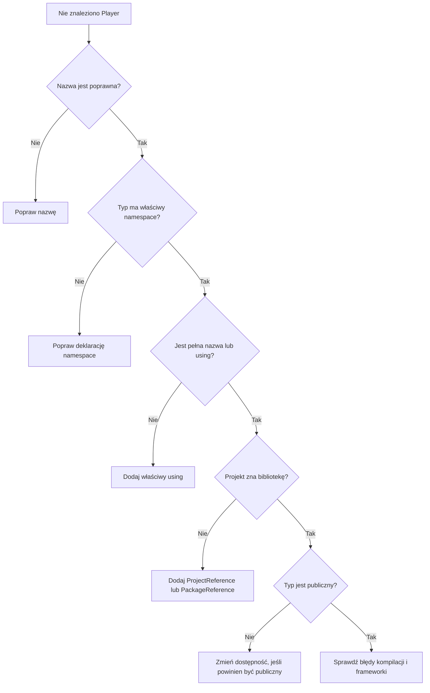

## Cel wykładu

Mały program może mieścić się w jednym pliku. Rosnąca gra szybko potrzebuje jednak osobnych klas gracza, przeciwników, walki i interfejsu. Samo dopisywanie plików nie wystarczy — trzeba rozumieć, **co kompiluje .NET**, **jak kod otrzymuje pełne nazwy** i **skąd projekt zna inne biblioteki**.

Po wykładzie potrafisz:

- odróżnić plik źródłowy, przestrzeń nazw, projekt `.csproj` i plik solucji `.sln`,
- utworzyć przestrzeń nazw za pomocą `namespace`,
- korzystać z typów przez pełną nazwę lub dyrektywę `using`,
- wyjaśnić, czego `using` nie robi,
- odczytać podstawowe elementy pliku `.csproj`,
- rozpoznać projekt aplikacji i bibliotekę klas,
- dodać zależność między projektami,
- zorganizować mały plik solucji `.sln` bez niepotrzebnego komplikowania jego struktury.

> **Cel praktyczny:** uporządkujemy kod gry tak, aby `Program.cs` uruchamiał aplikację, projekt `RogueGame.Core` zawierał reguły gry, a nazwy klas jasno wskazywały ich rolę.

W przykładach będą nam towarzyszyć:

- **Maciek Pierwszy — junior programista**, który próbuje naprawić brakujący typ, dopisując kolejne `using`,
- **Jan Kowalski — senior programista**, który wie, że import nie przywołuje biblioteki z internetu.

---

## 1. Cztery poziomy organizacji kodu

Słowa „plik źródłowy”, „namespace”, „projekt” i „plik solucji” opisują różne rzeczy.

| Element | Przykład | Odpowiedzialność |
|---|---|---|
| plik źródłowy | `Player.cs` | przechowuje tekst kodu |
| przestrzeń nazw | `RogueGame.Core.Characters` | nadaje typom logiczne, pełne nazwy |
| projekt | `RogueGame.Core.csproj` | określa, co i jak kompilujemy |
| plik solucji | `RogueGame.sln` | grupuje projekty `.csproj` do wspólnej pracy |



```text
RogueGame.sln
├── RogueGame.App
│   └── Program.cs
└── RogueGame.Core
    ├── Player.cs
    └── Enemy.cs

RogueGame.App zależy od RogueGame.Core.
Player i Enemy należą do RogueGame.Core.Characters.
```

> **Najważniejszy model:** plik `.cs` przechowuje kod, namespace nazywa typy, projekt `.csproj` je kompiluje, a plik solucji `.sln` grupuje projekty do wspólnej pracy.

### Pytanie do sali

Czy przeniesienie `Player.cs` do folderu `Characters` automatycznie zmieni jego namespace?

**Odpowiedź:** nie. Folder i namespace mogą mieć podobne nazwy, ale są od siebie niezależne. Namespace wynika z deklaracji w kodzie.

---

## 2. Namespace — adres typu

W jednym programie mogą istnieć klasy o tej samej krótkiej nazwie, jeśli należą do innych przestrzeni nazw:

```csharp
namespace RogueGame.Characters;

public class Player
{
    public string Name { get; } = "Ada";
}
```

```csharp
namespace RogueGame.Network;

public class Player
{
    public string ConnectionId { get; } = "abc-123";
}
```

Pełne nazwy to `RogueGame.Characters.Player` oraz `RogueGame.Network.Player`. Namespace zapobiega kolizji nazw i przekazuje informację o roli typu. Działa jak adres: `Player` jest nazwą osoby, a pełna nazwa dokładniej wskazuje, o kogo chodzi.

### Namespace blokowy i plikowy

Klasyczny zapis blokowy:

```csharp
namespace RogueGame.Characters
{
    public class Enemy
    {
    }
}
```

Zapis plikowy, dostępny we współczesnym C#:

```csharp
namespace RogueGame.Characters;

public class Enemy
{
}
```

W zapisie plikowym namespace obowiązuje do końca pliku i nie wymaga dodatkowej pary klamer. W jednym pliku może wystąpić tylko jedna deklaracja namespace tego rodzaju.

> **Konwencja kursu:** stosujemy zapis plikowy i zwykle dopasowujemy namespace do nazwy projektu oraz folderów, np. `RogueGame.Core.Characters`. Jest to konwencja pomagająca ludziom, a nie wymóg kompilatora.

Namespace nie jest obiektem. Nie można utworzyć go przez `new`; jest częścią nazwy typu.

---

## 3. `using` — krótszy zapis istniejącej nazwy

Bez dyrektywy `using` możemy użyć pełnej nazwy typu:

```csharp
RogueGame.Characters.Player player =
    new RogueGame.Characters.Player();
```

Po dodaniu importu zapis jest krótszy:

```csharp
using RogueGame.Characters;

Player player = new Player();
```

Obie wersje wskazują ten sam typ. `using RogueGame.Characters;` pozwala kompilatorowi odnaleźć `Player` po krótkiej nazwie w danym pliku.

> **Maciek:** Dodałem `using RogueGame.Core;`, więc projekt powinien już znać bibliotekę.
>
> **Jan:** Nie. Powiedziałeś tylko: „gdy biblioteka będzie znana, pozwól mi używać krótkich nazw”. Najpierw projekt musi otrzymać odwołanie do tej biblioteki.

### Czego `using` nie robi?

Dyrektywa `using`:

- nie pobiera pakietu,
- nie dodaje projektu `.csproj` do pliku solucji `.sln`,
- nie tworzy zależności między projektami,
- nie kopiuje ani nie uruchamia kodu,
- nie daje dostępu do elementów niedostępnych z danego miejsca.

`using` działa dopiero wtedy, gdy potrzebny typ jest już dostępny dla kompilowanego projektu.

Importy zwykle umieszczamy na początku pliku:

```csharp
using System;
using System.Collections.Generic;
using RogueGame.Characters;

namespace RogueGame.App;
```

Edytor często proponuje brakujący import. Warto sprawdzić, jaki namespace zostanie dodany — kilka bibliotek może oferować typ o tej samej nazwie.

---

## 4. Konflikt nazw i aliasy

Jeśli zaimportujemy dwie przestrzenie zawierające `Player`, krótka nazwa staje się niejednoznaczna:

```csharp
using RogueGame.Characters;
using RogueGame.Network;

// Player player = new Player(); // który Player?
```

Możemy użyć pełnej nazwy albo lokalnych aliasów:

```csharp
using GamePlayer = RogueGame.Characters.Player;
using NetworkPlayer = RogueGame.Network.Player;

GamePlayer hero = new GamePlayer();
NetworkPlayer connection = new NetworkPlayer();
```

Alias obowiązuje w pliku, w którym został zadeklarowany. Nie zmienia prawdziwej nazwy klasy.

### `using static`

`using static` pozwala używać dostępnych elementów statycznych bez nazwy typu:

```csharp
using static System.Math;

double distance = Sqrt(Pow(3, 2) + Pow(4, 2));
Console.WriteLine(distance); // 5
```

Bez niego zapisalibyśmy `Math.Sqrt(Math.Pow(3, 2) + Math.Pow(4, 2))`. Krócej nie zawsze znaczy czytelniej — `using static` stosujemy oszczędnie.

---

## 5. `global using` i importy niejawne

Zwykły `using` dotyczy jednego pliku. `global using` udostępnia import we wszystkich plikach danego projektu:

```csharp
global using RogueGame.Core.Characters;
```

Wspólne importy można umieścić w `GlobalUsings.cs`. Nie warto dodawać tam każdej przestrzeni — powinny być naprawdę powszechne i nie powodować konfliktów.

Nowoczesny projekt .NET może włączać **niejawne importy**:

```xml
<ImplicitUsings>enable</ImplicitUsings>
```

SDK dodaje wtedy zestaw często używanych przestrzeni właściwych dla typu projektu. Dlatego `Console` albo `List<T>` może działać mimo braku widocznego `using System;` lub `using System.Collections.Generic;`.

> **Pytanie:** „Nie widzę `using System`, a kod działa. Czy `System` nie jest już potrzebny?”
>
> **Odpowiedź:** nadal jest potrzebny. Import mógł zostać wygenerowany na podstawie `ImplicitUsings`.

W C# istnieje również instrukcja `using` służąca do zwalniania zasobów:

```csharp
using StreamReader reader = File.OpenText("save.txt");
```

Ma to samo słowo kluczowe, ale inne zadanie niż dyrektywa importu. Na tym wykładzie skupiamy się na `using Namespace.Name;`.

---

## 6. Projekt .NET i plik `.csproj`

Projekt opisuje jednostkę kompilacji. Plik `.csproj` informuje SDK między innymi, jaki wynik ma powstać, dla jakiej wersji .NET kompilujemy oraz od jakich projektów i pakietów zależy kod.

Przykładowy projekt aplikacji konsolowej:

```xml
<Project Sdk="Microsoft.NET.Sdk">
  <PropertyGroup>
    <OutputType>Exe</OutputType>
    <TargetFramework>net10.0</TargetFramework>
    <ImplicitUsings>enable</ImplicitUsings>
    <Nullable>enable</Nullable>
  </PropertyGroup>
</Project>
```

| Element | Znaczenie |
|---|---|
| `Sdk` | zestaw reguł budowania projektu |
| `OutputType` | `Exe` oznacza aplikację uruchamialną |
| `TargetFramework` | wersja platformy docelowej, np. `net10.0` |
| `ImplicitUsings` | generowanie typowych importów |
| `Nullable` | analiza możliwych wartości `null` |

SDK domyślnie uwzględnia pliki `.cs` z katalogu projektu i podkatalogów. Zwykle nie trzeba wpisywać każdego pliku do `.csproj`.

### Projekt to nie namespace

Projekt `RogueGame.Core` może zawierać kilka przestrzeni nazw:

```text
RogueGame.Core.Characters
RogueGame.Core.Combat
RogueGame.Core.Items
```

Namespace nie wyznacza automatycznie granicy kompilacji — robi to projekt.

---

## 7. Aplikacja i biblioteka klas

Projekt aplikacji konsolowej ma punkt wejścia i można go uruchomić. Biblioteka klas dostarcza typy innym projektom.



W bibliotece zwykle pomijamy `OutputType`:

```xml
<Project Sdk="Microsoft.NET.Sdk">
  <PropertyGroup>
    <TargetFramework>net10.0</TargetFramework>
    <ImplicitUsings>enable</ImplicitUsings>
    <Nullable>enable</Nullable>
  </PropertyGroup>
</Project>
```

Proponowana struktura:

```text
RogueGame/
├── RogueGame.sln
├── RogueGame.App/
│   ├── RogueGame.App.csproj
│   └── Program.cs
└── RogueGame.Core/
    ├── RogueGame.Core.csproj
    ├── Characters/
    │   ├── Player.cs
    │   └── Enemy.cs
    └── Combat/
        └── CombatRules.cs
```

Na początku jeden projekt jest wystarczający. Drugi ma sens, gdy chcemy utworzyć wyraźną, samodzielnie kompilowaną część, np. oddzielić reguły gry od interfejsu konsolowego.

> **Nie dzielimy projektu dla samej liczby folderów.** Folder porządkuje pliki taniej niż nowy projekt. Projekt wprowadza osobną kompilację i zależność.

---

## 8. Odwołanie między projektami

Samo umieszczenie dwóch projektów w pliku solucji `.sln` nie pozwala im używać swoich typów. Aplikacja musi otrzymać odwołanie do biblioteki:

```xml
<ItemGroup>
  <ProjectReference Include="..\RogueGame.Core\RogueGame.Core.csproj" />
</ItemGroup>
```

Można je dodać poleceniem:

```powershell
dotnet add .\RogueGame.App\RogueGame.App.csproj reference .\RogueGame.Core\RogueGame.Core.csproj
```

Dopiero potem kod aplikacji może zaimportować namespace i użyć publicznego typu:

```csharp
using RogueGame.Core.Characters;

Player player = new Player("Ada", 100);
Console.WriteLine($"{player.Name}: {player.Health} HP");
```



```text
ProjectReference  → biblioteka jest dostępna dla projektu
public            → typ jest dostępny poza biblioteką
using             → w pliku można użyć krótkiej nazwy
```

Jeśli `RogueGame.App` odwołuje się do `RogueGame.Core`, aplikacja może używać biblioteki. Nie oznacza to, że biblioteka może używać aplikacji.

```text
RogueGame.App  ──────►  RogueGame.Core
```

Biblioteka z regułami gry nie powinna zależeć od konsolowego `Program.cs`. Dzięki temu te same reguły można później wykorzystać w innym interfejsie.

---

## 9. Plik solucji `.sln` — wspólna lista projektów

Plik solucji `.sln` grupuje projekty `.csproj` używane razem. Ułatwia ich otwieranie, budowanie i pracę w IDE. Nie jest kolejnym projektem ani biblioteką i nie trafia do uruchomionej gry.

```powershell
dotnet new sln --name RogueGame --format sln
dotnet new console --name RogueGame.App
dotnet new classlib --name RogueGame.Core

dotnet sln .\RogueGame.sln add .\RogueGame.App\RogueGame.App.csproj
dotnet sln .\RogueGame.sln add .\RogueGame.Core\RogueGame.Core.csproj

dotnet add .\RogueGame.App\RogueGame.App.csproj reference .\RogueGame.Core\RogueGame.Core.csproj
dotnet build .\RogueGame.sln
dotnet run --project .\RogueGame.App\RogueGame.App.csproj
```

| Polecenie | Efekt |
|---|---|
| `dotnet new sln --format sln` | tworzy plik solucji `.sln` |
| `dotnet new console` | tworzy projekt aplikacji |
| `dotnet new classlib` | tworzy bibliotekę klas |
| `dotnet sln ... add` | rejestruje projekt `.csproj` w pliku `.sln` |
| `dotnet add ... reference` | tworzy zależność między projektami |
| `dotnet build` | przywraca zależności i kompiluje |
| `dotnet run --project` | buduje i uruchamia wskazaną aplikację |

> **Ważne:** „projekt `.csproj` jest wpisany do pliku `.sln`” i „projekt zależy od innego projektu” to niezależne informacje. Pierwszą ustala `dotnet sln add`, drugą `ProjectReference`.

---

## 10. Pakiet NuGet a projektowa biblioteka

Typ może pochodzić z tego samego projektu, innego projektu przez `ProjectReference`, zewnętrznego pakietu przez `PackageReference` albo z platformy .NET.

Pakiet dodajemy do konkretnego projektu:

```powershell
dotnet add .\RogueGame.App\RogueGame.App.csproj package Spectre.Console
```

W `.csproj` pojawi się zależność podobna do tej:

```xml
<ItemGroup>
  <PackageReference Include="Spectre.Console" Version="x.y.z" />
</ItemGroup>
```

Następnie w kodzie możemy potrzebować importu:

```csharp
using Spectre.Console;
```

Są to osobne kroki:

```text
PackageReference → projekt otrzymuje bibliotekę
using            → plik może używać krótszych nazw z namespace
```

Pakiet, projekt i namespace mogą mieć podobne nazwy, lecz nie muszą. Jeden pakiet może dostarczać wiele przestrzeni nazw.

> **Granica materiału:** rozpoznajemy `PackageReference` i jego związek z `using`. Szczegółowe wersjonowanie oraz publikowanie pakietów pozostają poza zakresem.

---

## 11. Refaktoryzacja gry krok po kroku

### Krok 1: tworzymy bibliotekę

```powershell
dotnet new classlib --name RogueGame.Core
```

### Krok 2: przenosimy i nazywamy typ

Plik `RogueGame.Core/Characters/Player.cs`:

```csharp
namespace RogueGame.Core.Characters;

public class Player
{
    public string Name { get; }
    public int Health { get; private set; }

    public Player(string name, int health)
    {
        Name = name;
        Health = health;
    }

    public void TakeDamage(int damage)
    {
        Health -= damage;

        if (Health < 0)
        {
            Health = 0;
        }
    }
}
```

Klasa jest `public`, aby można było użyć jej w innym projekcie.

### Krok 3: dodajemy projekty `.csproj` do pliku `.sln`

```powershell
dotnet sln .\RogueGame.sln add .\RogueGame.App\RogueGame.App.csproj
dotnet sln .\RogueGame.sln add .\RogueGame.Core\RogueGame.Core.csproj
```

### Krok 4: tworzymy zależność

```powershell
dotnet add .\RogueGame.App\RogueGame.App.csproj reference .\RogueGame.Core\RogueGame.Core.csproj
```

### Krok 5: importujemy namespace w `Program.cs`

```csharp
using RogueGame.Core.Characters;

Player player = new Player("Ada", 100);
player.TakeDamage(25);

Console.WriteLine($"{player.Name}: {player.Health} HP");
```

<!-- code-result: Ada: 75 HP -->

### Krok 6: budujemy całość

```powershell
dotnet build .\RogueGame.sln
```

Jeśli kompilacja się uda, aplikacja zna bibliotekę, a kod używa właściwego namespace.

---

## 12. Jak diagnozować „nie znaleziono typu”?

Gdy edytor podkreśla `Player`, nie dopisuj losowych importów. Sprawdź kolejne warstwy:



Praktyczna lista:

1. Czy wpisano dokładnie `Player`, a nie `player` lub `Plaeyr`?
2. Jaka jest pełna nazwa typu?
3. Czy plik ma odpowiedni `using`?
4. Czy typ znajduje się w tym samym projekcie?
5. Jeśli nie — czy istnieje `ProjectReference` albo `PackageReference`?
6. Czy typ z innego projektu jest `public`?
7. Czy projekt, od którego zależymy, sam się kompiluje?

### Typowe błędy

#### Namespace niezgodny z importem

```csharp
namespace RogueGame.Core.Character; // liczba pojedyncza
```

```csharp
using RogueGame.Core.Characters; // liczba mnoga
```

Te nazwy są różne. Kompilator nie poprawia ich na podstawie podobieństwa.

#### Dodanie projektu tylko do pliku `.sln`

Projekt jest widoczny w IDE, bo wpisano go do pliku `.sln`, ale aplikacja nie ma `ProjectReference`. Widoczność w drzewie pliku solucji nie jest zależnością kompilacji.

#### Klasa bez `public`

```csharp
class Player
{
}
```

Typ najwyższego poziomu bez jawnego modyfikatora jest domyślnie `internal`, więc nie jest dostępny z innego zestawu. Jeśli stanowi publiczną część biblioteki, deklarujemy `public class Player`.

#### Zależność cykliczna

```text
RogueGame.App  ──►  RogueGame.Core
       ▲                 │
       └─────────────────┘
```

Projekty nie powinny zależeć od siebie nawzajem. Trzeba zmienić podział odpowiedzialności i kierunek zależności.

#### Za dużo projektów

Osobny projekt dla `Player`, `Enemy` i każdej metody zwiększa koszt budowania i orientacji w kodzie. Najpierw używamy klas, namespace i folderów. Nowy projekt tworzymy dla wyraźnej granicy.

---

## 13. Zadanie aktywizujące: zaprojektuj strukturę

Gra zawiera `Program`, `Player`, `Enemy`, `CombatRules`, `ConsoleRenderer` i `Item`. Zaproponuj projekt, folder i namespace dla każdego typu.

Przykładowe rozwiązanie:

| Typ | Projekt | Folder | Namespace |
|---|---|---|---|
| `Program` | `RogueGame.App` | katalog główny | `RogueGame.App` |
| `ConsoleRenderer` | `RogueGame.App` | `UI` | `RogueGame.App.UI` |
| `Player`, `Enemy` | `RogueGame.Core` | `Characters` | `RogueGame.Core.Characters` |
| `CombatRules` | `RogueGame.Core` | `Combat` | `RogueGame.Core.Combat` |
| `Item` | `RogueGame.Core` | `Items` | `RogueGame.Core.Items` |

Nie jest to jedyne poprawne rozwiązanie. Podział powinien być konsekwentny, a nazwy opisywać odpowiedzialność.

### Ćwiczenie „co naprawić?”

`Program.cs` zawiera:

```csharp
using RogueGame.Core.Characters;

Player player = new Player("Ada", 100);
```

Klasa `Player` istnieje w `RogueGame.Core`, lecz aplikacja nadal zgłasza błąd. Jakich informacji brakuje?

**Odpowiedź:** trzeba sprawdzić `ProjectReference`, dostępność `public`, dokładny namespace oraz to, czy oba projekty się kompilują. Sam widoczny `using` nie rozstrzyga przyczyny.

---

## Ściąga

```csharp
// Player.cs
namespace RogueGame.Core.Characters;

public class Player
{
}
```

```csharp
// Program.cs — import i użycie
using RogueGame.Core.Characters;

Player player = new Player();
```

```csharp
// pełna nazwa bez using
RogueGame.Core.Characters.Player player =
    new RogueGame.Core.Characters.Player();
```

```csharp
// alias przy konflikcie nazw
using GamePlayer = RogueGame.Core.Characters.Player;
```

```xml
<!-- zależność od własnego projektu -->
<ProjectReference Include="..\RogueGame.Core\RogueGame.Core.csproj" />

<!-- zależność od pakietu zewnętrznego -->
<PackageReference Include="Nazwa.Pakietu" Version="x.y.z" />
```

```text
namespace        → pełna nazwa typu
using            → krótszy zapis nazwy w kodzie
project          → jednostka kompilacji
ProjectReference → zależność od własnego projektu
PackageReference → zależność od pakietu NuGet
plik .sln        → lista projektów do wspólnej pracy
```

---

## Pytania kontrolne

1. Czym różni się namespace od folderu?
2. Jaka jest pełna nazwa klasy `Player` z `RogueGame.Core.Characters`?
3. Co zmienia dyrektywa `using RogueGame.Core.Characters;`?
4. Dlaczego samo `using` nie wystarczy do użycia klasy z innego projektu?
5. Czym różni się `ProjectReference` od `PackageReference`?
6. Czy dodanie dwóch projektów `.csproj` do jednego pliku `.sln` tworzy między nimi zależność?
7. Po co bibliotece modyfikator `public` przy klasie używanej przez aplikację?
8. Kiedy alias `using GamePlayer = ...` jest przydatny?
9. Dlaczego `Console` może działać bez widocznego `using System;`?
10. W którą stronę powinna prowadzić zależność między aplikacją a biblioteką reguł gry?

## Podsumowanie

- Plik `.cs` przechowuje kod, namespace nadaje typowi logiczną nazwę, projekt `.csproj` go kompiluje, a plik solucji `.sln` grupuje projekty.
- Namespace i folder warto nazywać podobnie, ale kompilator nie wymaga takiej zgodności.
- `using` skraca odwołania do typów, które są już dostępne dla projektu.
- `global using` działa w całym projekcie, a `ImplicitUsings` może generować typowe importy.
- `.csproj` opisuje sposób budowania projektu oraz jego zależności.
- Aplikacja jest uruchamialna, a biblioteka klas dostarcza kod innym projektom.
- `ProjectReference` łączy własne projekty, a `PackageReference` dodaje pakiet zewnętrzny.
- Dodanie projektu do pliku `.sln` nie tworzy automatycznie zależności.
- Typ używany z innego projektu musi być dostępny, najczęściej `public`.
- Najpierw porządkujemy kod klasami, namespace i folderami; nowy projekt tworzymy dla wyraźnej granicy odpowiedzialności.
