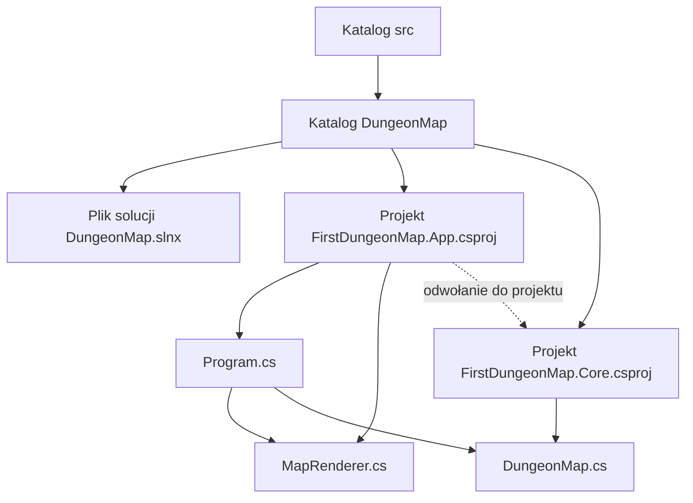

## Cel laboratorium

Zamienisz tablicę `char[,]` w model świata gry. Nauczysz się tworzyć prostokątną mapę, przechodzić po niej zagnieżdżonymi pętlami, rozróżniać współrzędne `x/y` od indeksów tablicy oraz bezpiecznie sprawdzać pola. Mapa jest jeszcze statyczna — sterowanie dodamy w kolejnym tygodniu.

Do wykonania jest **7 zadań**:

- zadania 1–2 — proste,
- zadania 3–4 — średnie,
- zadania 5–6 — trudniejsze,
- zadanie 7 — projekt integracyjny.

```text
char[,] → pętle zagnieżdżone → generator mapy → gracz jako nakładka → analiza mapy
```

## Zasady pracy

- Pracuj na własnym forku repozytorium startowego.
- Każde zadanie uruchamiaj przez przygotowane menu i osobną metodę `Task1()`–`Task7()`.
- Rozwiązuj zadania po kolei — późniejsze korzystają z wcześniejszych metod.
- Po każdym zadaniu zbuduj plik `.slnx` i uruchom projekt `FirstDungeonMap.App`.
- Logikę tworzenia i sprawdzania mapy umieszczaj w `FirstDungeonMap.Core`; obsługę konsoli i renderowanie w `FirstDungeonMap.App`.
- Zachowaj kierunek zależności `FirstDungeonMap.App → FirstDungeonMap.Core`.
- Nie wpisuj wymiarów na stałe w pętlach. Używaj `GetLength(0)` i `GetLength(1)`.
- Przed odczytem `map[y, x]` dla zmiennych współrzędnych sprawdź granice.
- Nie dodawaj jeszcze sterowania WASD.

> **Ważne:** obowiązuje konwencja `map[y, x]`. Pierwszy indeks oznacza wiersz `y`, drugi kolumnę `x`.

---

# Repozytorium i projekt startowy

Kod startowy znajduje się w repozytorium:

[https://github.com/PJMPR/pprg-lab01-template](https://github.com/PJMPR/pprg-lab01-template)

Przed rozpoczęciem laboratorium:

1. Otwórz podany link i zaloguj się w serwisie GitHub.
2. Użyj przycisku **Fork**, aby utworzyć kopię repozytorium na swoim koncie.
3. Sklonuj **własny fork** na komputer.
4. Otwórz sklonowany katalog w IDE.
5. Pracuj i zapisuj rozwiązania we własnym repozytorium.

Przykładowe klonowanie po wykonaniu forka:

```powershell
git clone https://github.com/TWOJ-LOGIN/pprg-lab01-template.git
cd pprg-lab01-template
```

Zastąp `TWOJ-LOGIN` własną nazwą użytkownika GitHub. Nie klonuj repozytorium prowadzącego jako miejsca docelowego swojej pracy, ponieważ nie będziesz mieć uprawnień do wysyłania do niego zmian.

## Import projektu do IDE

Projekt przeznaczony do zaimportowania lub otwarcia w IDE znajduje się w katalogu:

```text
src/DungeonMap
```

Projekt nazywa się **DungeonMap**. W zależności od używanego IDE otwórz katalog `src/DungeonMap` albo znajdujący się w nim plik solucji:

```text
src/DungeonMap/DungeonMap.slnx
```

Nie otwieraj pojedynczego pliku `.cs` zamiast całej solucji — IDE powinno wczytać oba projekty: `FirstDungeonMap.App` i `FirstDungeonMap.Core`.

Po sklonowaniu projekt startowy ma następującą strukturę:

```text
pprg-lab01-template/
├── src/
│   └── DungeonMap/
│       ├── DungeonMap.slnx
│       ├── FirstDungeonMap.App/
│       │   ├── FirstDungeonMap.App.csproj
│       │   ├── Program.cs
│       │   └── UI/
│       │       └── MapRenderer.cs
│       └── FirstDungeonMap.Core/
│           ├── FirstDungeonMap.Core.csproj
│           └── Maps/
│               └── DungeonMap.cs
└── README.md
```

Uruchomienie:

```powershell
dotnet build .\src\DungeonMap\DungeonMap.slnx
dotnet run --project .\src\DungeonMap\FirstDungeonMap.App\FirstDungeonMap.App.csproj
```

Oba projekty od początku się kompilują. Miejsca wymagające implementacji oznaczono `TODO`.

## Projekty, namespace i zależność

| Projekt | Namespace | Odpowiedzialność |
|---|---|---|
| `FirstDungeonMap.Core` | `FirstDungeonMap.Core.Maps` | tworzenie mapy, granice, dostępność i wyszukiwanie symboli |
| `FirstDungeonMap.App` | `FirstDungeonMap.App` | punkt wejścia, menu i przebieg zadań |
| `FirstDungeonMap.App` | `FirstDungeonMap.App.UI` | wyświetlanie mapy i legendy |



```text
src/
└── DungeonMap/
    ├── DungeonMap.slnx
    ├── FirstDungeonMap.App/
    │   ├── FirstDungeonMap.App.csproj
    │   ├── Program.cs
    │   └── UI/MapRenderer.cs
    └── FirstDungeonMap.Core/
        ├── FirstDungeonMap.Core.csproj
        └── Maps/DungeonMap.cs

Kierunek zależności: FirstDungeonMap.App → FirstDungeonMap.Core
```

`Core` nie zależy od `App` i nie używa `Console`. `App` uzyskuje dostęp do publicznej klasy `DungeonMap` dzięki `ProjectReference`, a zapis nazwy skraca dyrektywa:

```csharp
using FirstDungeonMap.Core.Maps;
```

## Krótkie wprowadzenie — `public` i `private`

Modyfikator dostępu określa, **z którego miejsca kodu można użyć klasy, metody albo pola**. W tym laboratorium korzystamy przede wszystkim z dwóch modyfikatorów:

- `public` — element jest dostępny również z kodu znajdującego się poza daną klasą, a w przypadku publicznych typów także z innego projektu mającego odpowiednie odwołanie,
- `private` — element jest dostępny wyłącznie wewnątrz klasy, w której został zadeklarowany.

```text
public  → część udostępniona innym klasom
private → szczegół działania ukryty wewnątrz klasy
```

W projekcie startowym aplikacja musi używać klasy `DungeonMap` z biblioteki `FirstDungeonMap.Core`. Dlatego klasa oraz wywoływane przez aplikację metody są `public`:

```csharp
namespace FirstDungeonMap.Core.Maps;

public static class DungeonMap
{
    public static char[,] Create(int width, int height)
    {
        // Implementacja metody.
    }

    public static bool IsInside(char[,] map, int x, int y)
    {
        // Implementacja metody.
    }
}
```

`Program` nie musi udostępniać metod poszczególnych zadań innym klasom. Są one szczegółem sterowania aplikacją, dlatego mogą być `private`:

```csharp
namespace FirstDungeonMap.App;

public static class Program
{
    public static void Main()
    {
        Task1();
    }

    private static void Task1()
    {
        Console.WriteLine("Uruchamiam zadanie 1.");
    }
}
```

Kod wewnątrz `Program` może wywołać `Task1()`, ale poniższe wywołanie zapisane w innej klasie nie skompiluje się:

```csharp
Program.Task1(); // błąd: Task1 jest private
```

### Przykład — ukrycie pola

Pole może być `private`, a jego wartość udostępniona przez publiczną metodę. Dzięki temu kod spoza klasy nie może przypadkowo zmienić danych bez kontroli:

```csharp
public class MapCounter
{
    private int visitedFields;

    public void VisitField()
    {
        visitedFields++;
    }

    public int GetVisitedFields()
    {
        return visitedFields;
    }
}
```

```csharp
MapCounter counter = new MapCounter();
counter.VisitField();

Console.WriteLine(counter.GetVisitedFields()); // działa
// counter.visitedFields = 100;                // błąd: pole jest private
```

<aside class="material-callout callout-note">
<strong>Uwaga</strong>
<p><code>public</code> nie oznacza „lepsze”, a <code>private</code> nie oznacza „zabronione”. Udostępniaj tylko te elementy, które rzeczywiście mają być używane przez inne klasy. Szczegóły pomocnicze pozostawiaj prywatne.</p>
</aside>

### Przykłady do analizy

#### Przykład A — metoda publiczna i prywatna

```csharp
public static class MapValidator
{
    public static bool HasExit(char[,] map)
    {
        return CountExits(map) == 1;
    }

    private static int CountExits(char[,] map)
    {
        int count = 0;

        for (int y = 0; y < map.GetLength(0); y++)
        {
            for (int x = 0; x < map.GetLength(1); x++)
            {
                if (map[y, x] == '>')
                {
                    count++;
                }
            }
        }

        return count;
    }
}
```

Przeanalizuj:

1. Którą metodę może wywołać `Program`?
2. Dlaczego `CountExits` może pozostać `private`?
3. Czy `HasExit` może wywołać `CountExits`?
4. Co zmieni się po ustawieniu `CountExits` jako `public`?

#### Przykład B — zbyt ograniczony dostęp

```csharp
private static class DungeonMap
{
    public static char[,] Create(int width, int height)
    {
        return new char[height, width];
    }
}
```

Przeanalizuj:

1. Czy `Program` z projektu `FirstDungeonMap.App` może użyć tej klasy?
2. Czy publiczna metoda pomaga, jeśli sama klasa nie jest dostępna?
3. Jaki modyfikator powinna mieć `DungeonMap`, aby aplikacja mogła jej używać?

> **Ważne:** ten dokładny przykład umieszczony bezpośrednio w przestrzeni nazw nie skompiluje się również dlatego, że typ najwyższego poziomu nie może być `private`. Klasy najwyższego poziomu używane przez inny projekt deklarujemy tutaj jako `public`.

#### Przykład C — prywatna metoda zadania

```csharp
public static class Program
{
    public static void Main()
    {
        Task2();
    }

    private static void Task2()
    {
        char[,] map = new char[5, 8];
        Console.WriteLine(map.Length);
    }
}
```

Przeanalizuj:

1. Dlaczego `Main` może wywołać `Task2`?
2. Czy `MapRenderer` może wywołać `Task2`?
3. Czy istnieje potrzeba zmiany `Task2` na `public`?

### Krótka zasada na laboratorium

- `DungeonMap`, `MapRenderer` i metody używane przez inne klasy — `public`.
- `Task1()`–`Task7()` oraz pomocnicze szczegóły używane tylko przez `Program` — `private`.
- Jeśli kompilator zgłasza niedostępność elementu, najpierw sprawdź modyfikator klasy, potem modyfikator metody, a następnie zależność projektu i namespace.

| Symbol | Znaczenie | Dane mapy? |
|---:|---|---|
| `#` | ściana | tak |
| `.` | podłoga | tak |
| `>` | wyjście | tak |
| `$` | skarb | tak |
| `@` | aktualna pozycja gracza | nie — nakładka podczas wyświetlania |

```text
             x (kolumna)
          0 1 2 3 4
        0 # # # # #
y       1 # . . > #
(wiersz)2 # . @ . #
        3 # # # # #

Gracz: x = 2, y = 2
Pole pod graczem: map[2, 2]
                        y  x
```

<aside class="material-callout callout-note">
<strong>Uwaga</strong>
<p>Pozycję opisujemy jako <code>(x, y)</code>, ale tablicę indeksujemy jako <code>map[y, x]</code>. Używaj jawnych nazw <code>x</code>, <code>y</code>, <code>width</code> i <code>height</code>.</p>
</aside>

---

# Poziom prosty — zadania 1–2

## Zadanie 1. Proste — odczyt i wyświetlenie `char[,]`

> **Maciek:** Mapa ma dwadzieścia pól, więc użyję `map.Length` w jednej pętli.
>
> **Jan:** Wtedy zgubisz informację, gdzie kończy się wiersz. Plansza potrzebuje dwóch wymiarów i dwóch pętli.

W `src/DungeonMap/FirstDungeonMap.App/Program.cs`, w `Task1()`, znajduje się gotowa tablica:

```csharp
char[,] map =
{
    { '#', '#', '#', '#', '#' },
    { '#', '.', '.', '>', '#' },
    { '#', '.', '.', '.', '#' },
    { '#', '#', '#', '#', '#' }
};
```

Wyświetl ją dwiema zagnieżdżonymi pętlami. Zewnętrzna przechodzi po `y`, wewnętrzna po `x`.

```text
#####
#..>#
#...#
#####
```

Następnie wypisz `map.Length`, liczbę wierszy, liczbę kolumn oraz symbol z pola `(3, 1)`.

### Eksperyment

Zamień `map[y, x]` na `map[x, y]` bez zmiany granic pętli. Obejrzyj wynik lub błąd, przywróć kod i wyjaśnij, dlaczego prostokątna mapa lepiej ujawnia pomyłkę niż kwadratowa.

### Kryteria ukończenia

- [ ] Wynik ma cztery wiersze po pięć znaków.
- [ ] Każda pętla korzysta z właściwego `GetLength`.
- [ ] Po każdym wierszu jest jedno `Console.WriteLine()`.
- [ ] Student odróżnia `Length` od `GetLength(dimension)`.
- [ ] Pole `map[1, 3]` zawiera `>`.

---

## Zadanie 2. Proste — podłoga i ściany na krawędziach

> **Maciek:** Wpisałem wszystkie 84 znaki ręcznie. Generator gotowy.
>
> **Jan:** To nie generator, tylko cierpliwa klawiatura. Niech rozmiar będzie danymi, a pętle zbudują resztę.

Utwórz mapę `12 × 7`:

```csharp
const int width = 12;
const int height = 7;
char[,] map = new char[height, width];
```

Każde pole krawędzi ma otrzymać `#`, a każde pole wewnętrzne `.`. Rozpoznaj krawędź jednym warunkiem: pierwszy lub ostatni wiersz albo pierwsza lub ostatnia kolumna.

```text
############
#..........#
#..........#
#..........#
#..........#
#..........#
############
```

Zmień wyłącznie `width` i `height` na `8 × 5`, a potem `20 × 4`. Kod nadal ma tworzyć zamknięty prostokąt.

### Kryteria ukończenia

- [ ] Tablica powstaje jako `new char[height, width]`.
- [ ] Każde pole otrzymuje `#` albo `.`.
- [ ] Wszystkie krawędzie są ścianami, a wnętrze podłogą.
- [ ] Kod działa dla innych prostokątnych rozmiarów bez zmiany pętli.

---

# Poziom średni — zadania 3–4

## Zadanie 3. Średnie — metody tworzenia i wyświetlania mapy

Przenieś generator do `src/DungeonMap/FirstDungeonMap.Core/Maps/DungeonMap.cs`, do metody `DungeonMap.Create(int width, int height)`. Metoda ma utworzyć, wypełnić i zwrócić mapę. Wymiar mniejszy niż `3` powinien zostać odrzucony z czytelnym komunikatem.

Uzupełnij też `src/DungeonMap/FirstDungeonMap.App/UI/MapRenderer.cs`, metodę `MapRenderer.Print(char[,] map, int playerX = -1, int playerY = -1)`. Parametry gracza mogą na tym etapie pozostać niewykorzystane. Renderowanie należy do aplikacji, ponieważ używa `Console`.

W `Task3()`:

1. utwórz mapę `12 × 7`,
2. ustaw wyjście `>` na `(10, 1)`,
3. ustaw skarb `$` na `(8, 4)`,
4. dodaj co najmniej trzy wewnętrzne ściany,
5. wyświetl mapę i legendę.

```csharp
char[,] map = DungeonMap.Create(12, 7);
map[1, 10] = '>'; // y = 1, x = 10
```

### Pytania

- Dlaczego `Create` zwraca `char[,]`, a `Print` zwraca `void`?
- Czy `Print` powinno zmieniać mapę?
- Co stanie się po `map[4, 12]` dla szerokości `12`?
- Dlaczego szerokość to `GetLength(1)`?

### Kryteria ukończenia

- [ ] Tworzenie w `Core` i wyświetlanie w `App` są rozdzielone.
- [ ] `Create` działa dla różnych poprawnych wymiarów.
- [ ] Mapa zawiera wyjście, skarb i przeszkody.
- [ ] Wszystkie symbole mieszczą się w tablicy.
- [ ] Legenda odpowiada symbolom.

---

## Zadanie 4. Średnie — gracz jako nakładka

> **Maciek:** Wstawiłem `@` do tablicy, przesunąłem gracza i pod nim zniknęło wyjście.
>
> **Jan:** Pomieszałeś teren z aktorem. Mapa mówi, co leży na polu; pozycja mówi, kto na nim stoi.

Przechowuj pozycję osobno:

```csharp
int playerX = 2;
int playerY = 2;
```

Rozbuduj `MapRenderer.Print`: na współrzędnych gracza wypisuj `@`, na innych polach `map[y, x]`. Nie zapisuj `@` do tablicy.

```text
czy x == playerX i y == playerY?
              |
        tak --+-- nie
         |         |
       wypisz @   wypisz map[y, x]
```

### Test

Wyświetl gracza na podłodze `(2, 2)`, a potem bezpośrednio wypisz `map[playerY, playerX]` — ma pozostać `.`. Powtórz dla wyjścia `(10, 1)` — wartość ma pozostać `>`.

### Kryteria ukończenia

- [ ] Pozycja gracza nie jest zapisana w mapie.
- [ ] `@` pojawia się dokładnie raz.
- [ ] Symbol pod graczem pozostaje niezmieniony.
- [ ] Warunek porównuje jednocześnie `x` i `y`.
- [ ] Student rozróżnia dane świata od prezentacji.

---

# Poziom trudniejszy — zadania 5–6

## Zadanie 5. Trudniejsze — bezpieczne współrzędne

W klasie `FirstDungeonMap.Core.Maps.DungeonMap` uzupełnij `IsInside(char[,] map, int x, int y)`. Wynik jest prawdziwy tylko dla:

```text
0 <= x < szerokość
0 <= y < wysokość
```

Następnie uzupełnij `IsWalkable`. Pole jest dostępne, jeśli leży na mapie i nie zawiera `#`.

<aside class="material-callout callout-hint">
<strong>Podpowiedź</strong>
<p>Warunki z <code>&amp;&amp;</code> są sprawdzane od lewej. Najpierw sprawdź granice, dopiero potem odczytaj <code>map[y, x]</code>.</p>
</aside>

| Współrzędne | `IsInside` | `IsWalkable` | Powód |
|---|---:|---:|---|
| `(2, 2)` | `true` | `true` | podłoga |
| `(0, 0)` | `true` | `false` | ściana |
| `(-1, 2)` | `false` | `false` | ujemne `x` |
| `(2, -1)` | `false` | `false` | ujemne `y` |
| `(12, 3)` | `false` | `false` | `x` równe szerokości |
| `(3, 7)` | `false` | `false` | `y` równe wysokości |
| `(10, 1)` | `true` | `true` | wyjście |

### Eksperyment

Tymczasowo odczytaj tablicę przed sprawdzeniem granic i wywołaj metodę dla `(-1, 2)`. Zapisz nazwę wyjątku, potem przywróć bezpieczną kolejność.

### Kryteria ukończenia

- [ ] Sprawdzane są cztery granice.
- [ ] Wartość równa szerokości lub wysokości jest poza mapą.
- [ ] Tablica nie jest odczytywana przed sprawdzeniem granic.
- [ ] Ściana jest niedostępna, podłoga i wyjście dostępne.
- [ ] Testy nie kończą programu wyjątkiem.

---

## Zadanie 6. Trudniejsze — raport i wyszukiwanie

Uzupełnij:

```csharp
public static int CountSymbol(char[,] map, char symbol)

public static bool TryFindSymbol(
    char[,] map, char symbol,
    out int foundX, out int foundY)
```

`CountSymbol` liczy wskazany znak. `TryFindSymbol` znajduje pierwsze wystąpienie w kolejności wierszami. Gdy symbolu nie ma, zwraca `false` i ustawia obie współrzędne na `-1`.

Przygotuj raport:

```text
Rozmiar: 12 × 7
Ściany: ...
Podłoga: ...
Skarby: 1
Wyjście: x=10, y=1
```

Suma liczników wszystkich symboli ma odpowiadać `map.Length`.

### Warunki

- Nie używaj LINQ — ćwiczysz pętle zagnieżdżone.
- Przetestuj znalezienie `>` i brak `!`.
- Nie zakładaj konkretnego rozmiaru.
- Współrzędne zwracaj jako `(x, y)`, mimo że odczyt to `map[y, x]`.

### Kryteria ukończenia

- [ ] Każde pole jest sprawdzane dokładnie raz.
- [ ] Znalezione współrzędne są w kolejności `(x, y)`.
- [ ] Brak symbolu daje `false`, `-1`, `-1`.
- [ ] Raport działa dla map prostokątnych różnych rozmiarów.
- [ ] Suma liczników odpowiada liczbie pól.

---

# Zadanie projektowe

## Zadanie 7. Projekt — „Kartograf lochu”

> **Maciek:** Zrobię mapę 100 × 100, dodam ruch, walkę i zapis gry.
>
> **Jan:** Najpierw poprawnie narysuj jeden loch i opisz jego pola. Sterowanie zaczeka.

Zaprojektuj własną statyczną mapę, używając narzędzi z zadań 1–6.

## Wymagania obowiązkowe

Mapa musi:

1. mieć co najmniej `15` kolumn i `8` wierszy,
2. być prostokątna, nie kwadratowa,
3. mieć `#` na całej zewnętrznej krawędzi,
4. zawierać `.`, jedno `>` i co najmniej dwa `$`,
5. zawierać wewnętrzną ścianę z przejściem,
6. posiadać gracza przechowywanego jako osobne `playerX` i `playerY`,
7. nie przechowywać `@` w tablicy,
8. być tworzona i wyświetlana przez osobne metody,
9. używać `GetLength` w pętlach,
10. bezpiecznie sprawdzać dowolne współrzędne.

## Etapy

1. Utwórz mapę przez `DungeonMap.Create`.
2. Dodaj wewnętrzne ściany za pomocą pętli.
3. Pozostaw w ścianie przynajmniej jedno przejście `.`.
4. Umieść wyjście i skarby.
5. Wybierz dostępne pole startowe gracza.
6. Wyświetl mapę i legendę.
7. Wygeneruj raport.
8. Uruchom scenariusze testowe.

## Raport

Wyświetl szerokość, wysokość, liczbę wszystkich pól, liczbę każdego symbolu, współrzędne gracza i wyjścia oraz informację, czy start jest dostępny. Następnie pobierz od użytkownika `x` i `y`; jeśli pole istnieje, pokaż jego symbol, w przeciwnym razie czytelny komunikat. Nie odczytuj pola poza mapą.

## Walidacja

Program ma wykrywać:

- brak wyjścia,
- więcej niż jedno wyjście,
- brak skarbów,
- gracza poza mapą,
- gracza na ścianie.

## Przykładowy wynik

```text
=== KARTOGRAF LOCHU ===
####################
#.................>#
#...$..#...........#
#......#...........#
#..................#
#......#...........#
#......#.......$...#
#.@....#...........#
#..................#
####################
Legenda: # ściana | . podłoga | @ gracz | > wyjście | $ skarb

Rozmiar: 20 × 10 (200 pól)
Skarby: 2
Gracz: x=2, y=7
Wyjście: x=18, y=1
Mapa jest poprawna.
```

## Scenariusze testowe

Sprawdź poprawną mapę, narożnik `(0, 0)`, pole gracza, pole wyjścia, współrzędne ujemne, `x` równe szerokości, `y` równe wysokości, brak wyjścia, dwa wyjścia oraz to, że pole pod graczem nie zawiera `@`.

## Ograniczenia

- Nie zastępuj `char[,]` listą napisów ani wielowierszowym napisem.
- Nie dodawaj ruchu, walki ani losowego generatora.
- Nie używaj `IndexOutOfRangeException` jako sposobu sprawdzania granic.
- Nie duplikuj pętli wyświetlającej — korzystaj z `MapRenderer.Print`.
- Nie dodawaj `Console.WriteLine` ani zależności do `FirstDungeonMap.App` w projekcie `Core`.

## Kryteria ukończenia projektu

- [ ] Mapa jest prostokątna i spełnia minimalny rozmiar.
- [ ] Krawędzie, przejścia, skarby i wyjście są czytelne.
- [ ] Pozycja gracza jest niezależna od mapy.
- [ ] Odczyty zmiennych współrzędnych są poprzedzone walidacją.
- [ ] Raport korzysta z metod analizy mapy.
- [ ] Walidacja rozpoznaje pięć wymaganych problemów.
- [ ] Błędne dane nie kończą programu wyjątkiem.
- [ ] Kod buduje się bez błędów.
- [ ] Oba projekty mają spójne namespace, a zależność prowadzi tylko z `App` do `Core`.

---

## Pytania kontrolne

1. Co oznaczają `GetLength(0)` i `GetLength(1)`?
2. Czym `Length` różni się od `GetLength(0)`?
3. Dlaczego tworzymy `new char[height, width]`?
4. Jak przeliczyć `(x, y)` na indeks tablicy?
5. Dlaczego mapa prostokątna ujawnia pomyłkę indeksów?
6. Jak rozpoznać pole na krawędzi?
7. Dlaczego granice sprawdzamy przed `map[y, x]`?
8. Dlaczego `x == map.GetLength(1)` jest poza mapą?
9. Dlaczego `@` nie powinno zastępować terenu?
10. Jak znaleźć symbol bez założenia rozmiaru?
11. Co zwrócić, jeśli symbol nie istnieje?
12. Dlaczego `DungeonMap` należy do `Core`, a `MapRenderer` do `App`?
13. Czym różnią się `ProjectReference` i dyrektywa `using`?

## Co oddać

- kompletny projekt oparty na starterze,
- rozwiązania `Task1()`–`Task7()`,
- uzupełnione klasy `DungeonMap` i `MapRenderer`,
- oba projekty oraz plik `DungeonMap.slnx`,
- przykład działania projektu lub zrzut konsoli,
- listę wykonanych scenariuszy testowych,
- odpowiedzi z eksperymentów w zadaniach 1, 4 i 5.

## Repozytorium do oddania

Do oddania przygotuj własny fork repozytorium `pprg-lab01-template` z rozwiązaniami i historią commitów. Inny układ mapy lub podział metod jest prawidłowy, jeśli spełnia wymagania i potrafisz go uzasadnić.

## Podsumowanie

Po laboratorium potrafisz deklarować tablice 2D, odczytywać ich wymiary, przechodzić po mapie pętlami, stosować `map[y, x]`, generować teren, oddzielać pozycję gracza od danych, sprawdzać granice oraz liczyć i wyszukiwać symbole.
